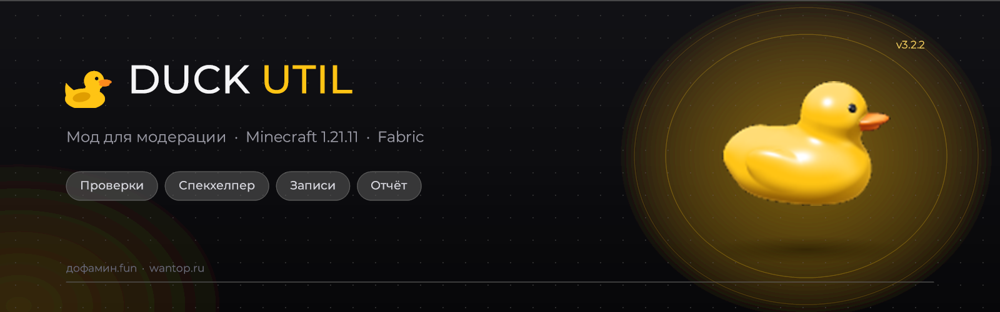

# Duck Util

Обновление **3.3**: [единый список изменений](reference/changelog.md) — El Drifto, новые эффекты, учёт SystemDLC, диагностика активации и обмен конфигами.

Добро пожаловать в руководство Duck Util — клиентского мода для Minecraft **1.21.11** на Fabric. Здесь собраны инструкции по установке, настройке и функциям мода.

> Duck Util устанавливается только у вас. Для игры на сервере сам сервер менять не нужно.

## Начните отсюда

1. [Установка мода](nachalo-raboty/installation.md)
2. [Первый запуск и активация](nachalo-raboty/first-launch.md)
3. [Как открыть меню и настроить мод](nastroika/duck-screen.md)

## Что есть в моде

| Возможность            | Что можно делать                                                               |
| ---------------------- | ------------------------------------------------------------------------------ |
| **Внешний вид**        | Настраивать меню, темы и HUD                                                   |
| **Модули**             | Включать и настраивать визуальные и игровые функции                            |
| **Цели**               | Отмечать игроков и пользоваться быстрыми действиями                            |
| **Модерация**          | Удобнее работать с проверками и записями событий                               |
| **Социальные функции** | Играть в дурака и бильярд, смотреть статусы и рейтинги                         |
| **Запись**             | Сохранять игровые записи и клипы, если эти функции есть в установленной версии |

## Быстрые ссылки

* [Обзор возможностей](vozmozhnosti/overview.md)
* [Список модулей](vozmozhnosti/modules-overview.md)
* [Клавиши и управление](nastroika/keybindings.md)
* [Команды](nastroika/commands.md)
* [Решение проблем](reshenie-problem/common-issues.md)

## Нужна помощь?

Если мод не запускается или функция ведёт себя не так, как ожидалось, начните с раздела [Решение проблем](reshenie-problem/common-issues.md). Для обращения за помощью приложите версию Minecraft, версию Duck Util и файл `logs/latest.log`, предварительно удалив из него личные данные.
