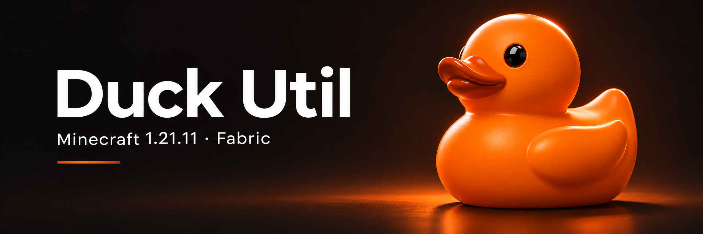

# Duck Util

Ваши инструменты для проверок и модерации, удобное меню и настраиваемый HUD. Duck Util работает на клиенте **Minecraft 1.21.11 с Fabric** — устанавливать мод на игровой сервер не нужно.


**Актуальная версия — 3.5.** [New Year Mode](moduli/interface.md) добавляет снежные шапки на меню и диалоги, сохраняя HUD без снега. Исправлен предпросмотр Dark Summon, добавлена бесконечная история рабочего чата, убраны двойные интервалы и вывод сканирования «Ветки» в рабочую ленту. [История обновлений →](reference/changelog.md)

Также в 3.4: [отдельный рабочий чат](moduli/work-chat.md) и [свой набор случайных бан-эффектов](moduli/ban-effect.md) с частотами и запретом повторов.


## Начать пользоваться

<table data-view="cards"><thead><tr><th></th><th></th><th data-hidden data-card-target data-type="content-ref"></th></tr></thead><tbody><tr><td><strong>Установить мод</strong></td><td>Что скачать и куда положить JAR.</td><td><a href="nachalo-raboty/installation.md">installation.md</a></td></tr><tr><td><strong>Первый запуск</strong></td><td>Активация и первые настройки.</td><td><a href="nachalo-raboty/first-launch.md">first-launch.md</a></td></tr><tr><td><strong>Освоить меню</strong></td><td>Разделы Duck Util и управление функциями.</td><td><a href="nastroika/duck-screen.md">duck-screen.md</a></td></tr><tr><td><strong>Посмотреть интерфейс</strong></td><td>Меню, HUD, модерация и игры в скриншотах.</td><td><a href="reference/screenshots.md">screenshots.md</a></td></tr></tbody></table>

## Под ваши задачи

<table data-view="cards"><thead><tr><th></th><th></th><th data-hidden data-card-target data-type="content-ref"></th></tr></thead><tbody><tr><td><strong>Проверки и отчёты</strong></td><td>Меню цели, наказания и учёт SystemDLC.</td><td><a href="vozmozhnosti/ban-system.md">ban-system.md</a></td></tr><tr><td><strong>Эффекты бана</strong></td><td>Drone, Северный топор, El Drifto и другие сцены.</td><td><a href="moduli/ban-effect.md">ban-effect.md</a></td></tr><tr><td><strong>Последняя дуэль</strong></td><td>Меч и отдельная камера для завершающего удара по копии.</td><td><a href="moduli/last-duel.md">last-duel.md</a></td></tr><tr><td><strong>Вызов на проверку</strong></td><td>Dark Summon: чёрные руки обхватывают игрока и поднимают вверх.</td><td><a href="moduli/dark-summon.md">dark-summon.md</a></td></tr><tr><td><strong>Автоматический вход</strong></td><td>Auto Key: ключ и отложенная команда /ca teamtg.</td><td><a href="moduli/auto-key.md">auto-key.md</a></td></tr><tr><td><strong>Конфиги по коду</strong></td><td>Сохранить настройки и поделиться ими.</td><td><a href="vozmozhnosti/configs.md">configs.md</a></td></tr><tr><td><strong>HUD и оформление</strong></td><td>Темы, панели и редактор элементов экрана.</td><td><a href="vozmozhnosti/hud.md">hud.md</a></td></tr><tr><td><strong>Модули</strong></td><td>Найти функцию и разобраться в её настройках.</td><td><a href="vozmozhnosti/modules-overview.md">modules-overview.md</a></td></tr><tr><td><strong>Записи и клипы</strong></td><td>Сохранить нужный момент игры.</td><td><a href="vozmozhnosti/records.md">records.md</a></td></tr></tbody></table>

## Всегда под рукой

**Right Shift** — главное меню · **V** — меню цели. Клавиши можно изменить в настройках.

[Все клавиши](nastroika/keybindings.md) · [Команды](nastroika/commands.md) · [Обзор возможностей](vozmozhnosti/overview.md)


**Не получается активировать мод?** В 3.3 сообщение объясняет причину сбоя. Найдите его в [разборе ошибок активации](reshenie-problem/license-issues.md). Лицензионный ключ никому не отправляйте.


Другие вопросы — в разделе [Решение проблем](reshenie-problem/common-issues.md). При обращении за помощью укажите версии Minecraft и Duck Util и приложите текст ошибки. Перед отправкой `logs/latest.log` удалите из него личные данные.
