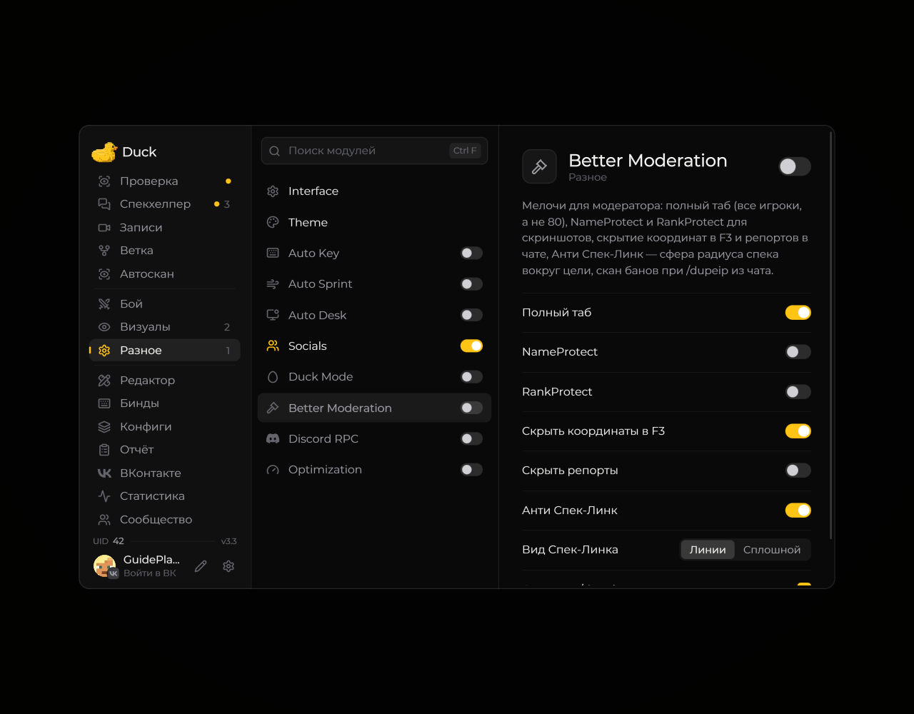

# Модули

Модули включаются и настраиваются в меню Duck Util. Откройте меню клавишей **Right Shift**, выберите раздел и наведите курсор на параметр, чтобы увидеть подсказку. Некоторые функции требуют активной лицензии или поддержки сервера.

<!-- screenshots-3.3 -->
<figure><figcaption>
Модуль и его параметры в меню · Duck Util 3.3.
</figcaption></figure>
<!-- /screenshots-3.3 -->

## Внешний вид и HUD

| Модуль                                                               | Назначение                                            |
| -------------------------------------------------------------------- | ----------------------------------------------------- |
| **Interface**, **Theme**                                             | Меню, фон и цветовое оформление                       |
| **HUD**, **Notifications**, **Image HUD**                            | Элементы экрана, уведомления и изображения            |
| **Fullbright**, **Zoom**, **Aspect Ratio**, **Custom Fog**, **Wet**  | Изменение изображения и отдельных визуальных эффектов |
| **Target Render**, **Target HUD**, **Target Arrow**, **Target Menu** | Отображение цели и действия с ней                     |
| **Overhead Items**, **Duck Hat**, **Player Model**                   | Предметы и модели игроков                             |
| [**Ban Effect**](../moduli/ban-effect.md) | Сцены наказания: Drone, топор, El Drifto и другие |
| [**Dark Summon**](../moduli/dark-summon.md) | Боковой захват и подъём копии при вызове на проверку |

## Игровые инструменты и модерация

| Модуль                                                                    | Назначение                                                   |
| ------------------------------------------------------------------------- | ------------------------------------------------------------ |
| [**Auto Key**](../moduli/auto-key.md) | `/key` после входа и отложенная `/ca teamtg` |
| **Auto Sprint** | Автоматический бег |
| [**Auto Desk**](../moduli/auto-desk.md) | Запуск AnyDesk/RustDesk с ID игрока на проверке |
| **Auto Scan**, **Auto DupeIP**, **Branch** | Поиск игроков и связанных аккаунтов |
| **Better Moderation**, **Cheat Detector**, **Cheat Base** | Инструменты модерации и проверки |

Работа этих функций зависит от сервера и прав вашей учётной записи. Следуйте правилам сервера.

## Остальное

| Модуль                       | Назначение                              |
| ---------------------------- | --------------------------------------- |
| **Socials**, **Discord RPC** | Социальные возможности и статус Discord |
| **Optimization**             | Параметры производительности клиента    |
| [**Duck Mode**](../moduli/duck-mode.md) | Прокрутка разделов и падение меню в игровой мир |

Подробные страницы модулей собраны в разделе **Модули** в меню книги.
