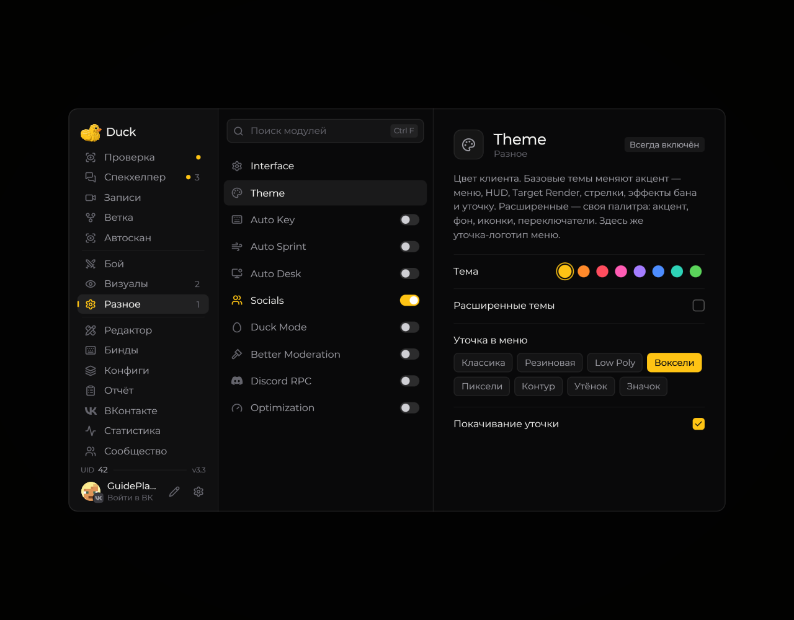

# Обзор возможностей

Duck Util собирает интерфейсные, игровые и модераторские инструменты в одном клиентском меню. Набор доступных функций зависит от версии мода, активной лицензии и возможностей сервера.

<!-- screenshots-3.3 -->
<figure><figcaption>
Единое меню модулей Duck Util · Duck Util 3.3.
</figcaption></figure>
<!-- /screenshots-3.3 -->

## Меню и внешний вид

Настраивайте темы, фон и анимации меню, а также расположение элементов HUD. Большинство параметров сопровождается подсказкой при наведении.

Руководство обновлено для **3.11**. Новые сцены и изменения собраны в [истории обновлений](../reference/changelog.md).

## HUD и визуальные модули

На экран можно вывести выбранные игровые сведения, например координаты, FPS, цель и медиаплеер. Другие модули меняют отдельные визуальные эффекты. Подробнее — в разделах [HUD](hud.md) и [модулей](modules-overview.md).

## Цели и модерация

Меню цели открывается клавишей **V**. Система целей и инструменты модерации помогают работать с игроками, проверками и событиями на серверах, которые поддерживают соответствующие команды. Подробности — [система целей](target-system.md) и [модерация и баны](ban-system.md).

[Dark Summon](../moduli/dark-summon.md) показывает руки при вызове на проверку. [Ban Effect](../moduli/ban-effect.md) добавляет Drone, Северный топор, El Drifto и другие сцены наказания. [Последняя дуэль](../moduli/last-duel.md) позволяет нанести локальный завершающий удар по копии после уже выданного бана.

Для входа [Auto Key](../moduli/auto-key.md) отправляет серверный ключ и, при включённой настройке, `/ca teamtg` с выбранной задержкой.

## Социальные функции и записи

В моде есть социальные экраны, игры и функции записи. Интеграции и сетевые возможности могут требовать входа, активной лицензии или отдельной настройки. См. [социальные функции](social.md) и [запись экрана](records.md).

## Производительность

Модуль **Optimization** включает параметры оптимизации клиента. Эффект зависит от компьютера и графических настроек; при проблемах выключайте изменения по одному.
