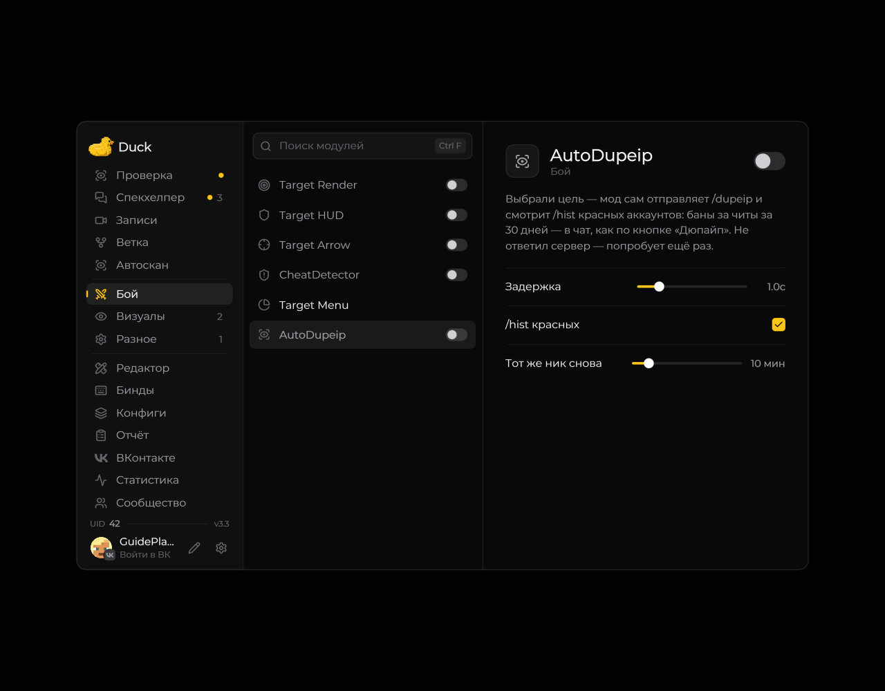

# Auto DupeIP — поиск связанных аккаунтов

Модуль **AutoDupeip** в разделе **Бой** отправляет `/dupeip` после выбора цели. Пока вы быстро перебираете игроков, запрос не уходит: цель должна оставаться выбранной дольше установленной задержки.

<!-- screenshots-3.3 -->
<figure><figcaption>
Auto DupeIP — поиск связанных аккаунтов — настройки · Duck Util 3.3.
</figcaption></figure>
<!-- /screenshots-3.3 -->

| Параметр | По умолчанию | Диапазон или действие |
| --- | --- | --- |
| Задержка | 1 секунда | 0–5 секунд до отправки `/dupeip` |
| /hist красных | Включено | Проверяет историю красных аккаунтов и показывает баны за читы за 30 дней |
| Тот же ник снова | 10 минут | 1–60 минут перед повторным сканированием того же игрока |

Если история выключена, остаются `/dupeip` и список красных аккаунтов без автоматических запросов `/hist`. При другом активном скане или риске флуда мод ждёт; если сервер не ответил, предусмотрен повтор.

Отдельно можно нажать на красный ник в чате и отправить `/hist ник` вручную. Дополнительной подсказки при наведении больше нет. [Команды](../nastroika/commands.md).
