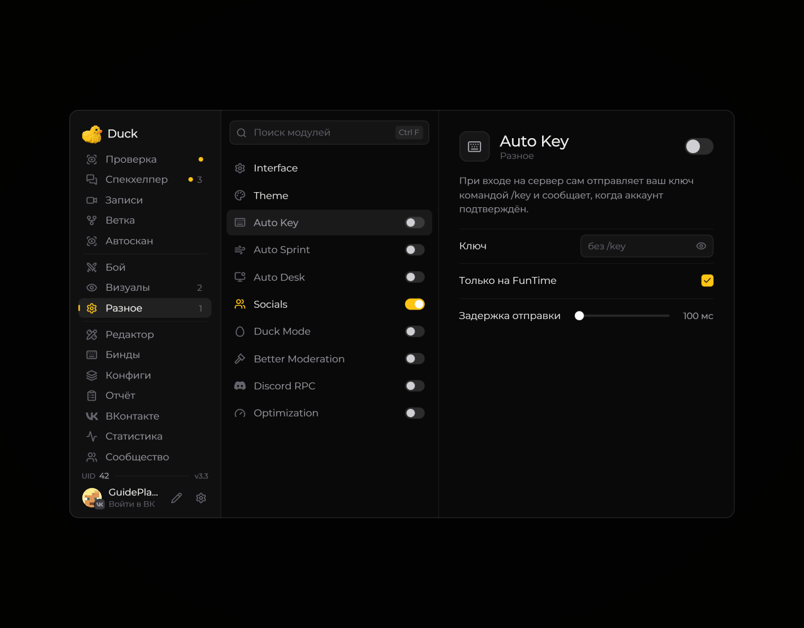

# Auto Key — ключ и /ca teamtg

Модуль в разделе **Разное** отправляет `/key ваш_ключ` после входа на сервер и сообщает о подтверждении аккаунта. Это серверный ключ; [лицензия Duck Util](../nastroika/license-screen.md) активируется отдельно.

## Настройка

1. Откройте **Right Shift → Разное → Auto Key**.
2. В поле **Ключ** вставьте свой ключ без `/key`. Поле скрыто точками; глаз показывает значение.
3. Оставьте **Только на FunTime** включённым для адресов `funtime.su`, `funtime.sh`, `funtime.me` и их поддоменов.
4. Выберите задержку, включите модуль и переподключитесь к серверу.

| Настройка | По умолчанию | Диапазон или действие |
| --- | --- | --- |
| Только на FunTime | Включено | Ограничивает отправку ключа адресами FunTime |
| Задержка отправки | 100 мс | 0–3000 мс, шаг 50 мс после входа |
| Авто /ca teamtg | Выключено | Отправляет `/ca teamtg` после `/key` |
| Задержка /ca teamtg | 500 мс | 0–10000 мс, шаг 50 мс после отправки ключа |

## Авто /ca teamtg

Включите чекбокс **Авто /ca teamtg** — под ним появится ползунок задержки. Например, при **700 мс** сначала отправится `/key`, затем, после паузы, `/ca teamtg`.

Отсчёт начинается при отправке ключа, а не при получении сообщения о подтверждении. Команда выполняется на ближайшем тике после выбранного времени; при **0 мс** порядок остаётся прежним: сначала `/key`, затем `/ca teamtg`.

Это работает и после ручной отправки `/key ключ`, пока Auto Key включён. Ограничение **Только на FunTime** действует и на дополнительную команду. Повторная отправка ключа заменяет ожидающее задание; выключение модуля, снятие чекбокса и смена подключения отменяют его.

## Если команда не отправляется

- Проверьте включённость самого Auto Key и чекбокса дополнительной команды.
- Для другого сервера снимите **Только на FunTime**, если хотите использовать там модуль.
- Убедитесь, что сервер поддерживает нужные команды и разрешает их вашему аккаунту.
- Если пришло «Сервер не подтвердил ключ», проверьте значение ключа. Мод ожидает сообщение **«Аккаунт подтвержден!»**; отсутствие этого сообщения не отменяет уже запланированную `/ca teamtg`.

Основные настройки в версии 3.3

<figure><figcaption>
Архивный снимок 3.3. Чекбокс /ca teamtg и его задержка добавлены в 3.4.
</figcaption></figure>

