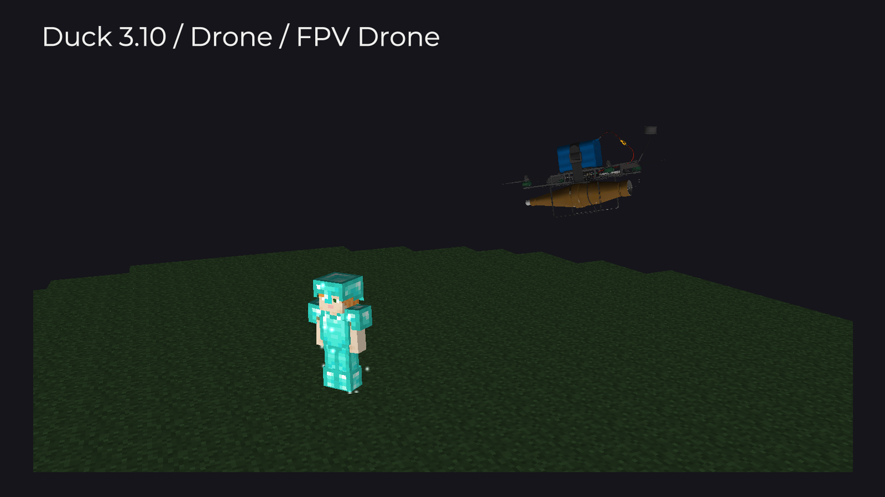
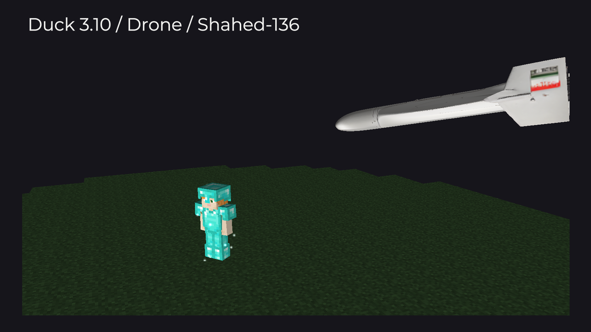
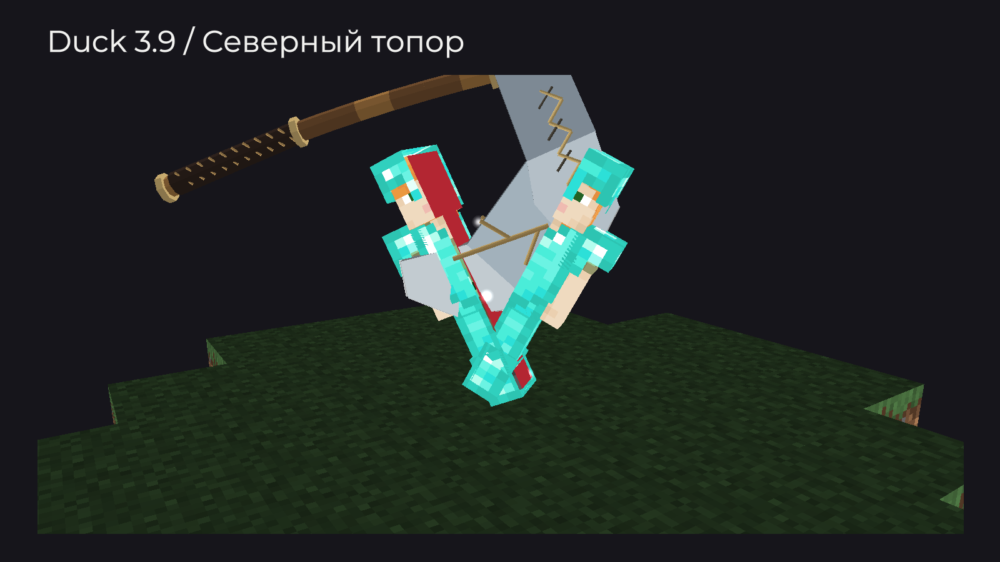
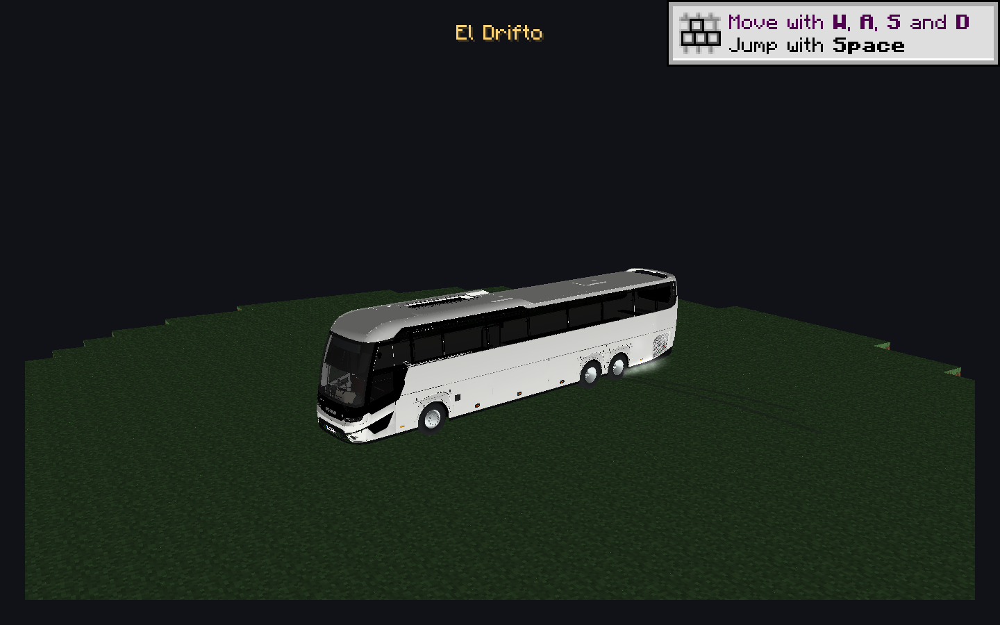

# Ban Effect — эффект бана

Откройте **Right Shift → Визуалы → Ban Effect**, включите модуль и выберите эффект. Он запускается при наказании из [меню цели](../nastroika/target-menu-ui.md), открываемого клавишей **V**. Если цель не загружена в вашем мире, команда отправляется сразу без сцены. Эффекты видите только вы.

## Когда отправляется наказание

| Эффект | Команда и запись в отчёт |
| --- | --- |
| Танк, El Drifto, Последняя дуэль | Сразу; анимация работает с замороженной копией |
| Drone | Один раз при столкновении дрона с копией |
| Северный топор | Один раз при разрубании |
| Большинство остальных сцен | В момент удара выбранного эффекта |

## Drone

Дрон появляется в воздухе, разгоняется по дуге и врезается носом в копию игрока. Взрыв сопровождается вспышкой, дымом, искрами и ударной волной. Мотор звучит из позиции дрона и останавливается при столкновении или завершении сцены.



<figure><figcaption>
FPV Drone. Кадр из отдельной демонстрационной сцены 3.10.
</figcaption></figure>


<figure><figcaption>
Shahed-136. Кадр из отдельной демонстрационной сцены 3.10.
</figcaption></figure>



| Настройка | По умолчанию | Диапазон |
| --- | --- | --- |
| Модель дрона | FPV Drone | FPV Drone / Shahed-136 |
| Скорость дрона | 10 бл/с | 3–24 бл/с |
| Громкость дрона | 75% | 0–100% |
| Сила взрыва | 1,5× | 0,5–3× |

Скорость задаёт средний темп полёта с разгоном. Громкость управляет мотором и взрывом; **0%** отключает их. Сила меняет размер вспышки, кольца, частиц и тряску камеры. Взрыв не разрушает блоки и не наносит реального урона. Обе модели встроены в JAR, отдельно скачивать их не нужно.

## Последняя дуэль

После немедленных бана и отчёта остаётся копия со скином, бронёй и вещами игрока. Появляются отдельная камера, меч и хотбар. Подойдите и нажмите **ЛКМ**, чтобы нанести завершающий удар только этой копии; после сцены камера вернётся в исходный ракурс.

В **3.11** исправлен запуск из всех трёх меню цели. Камера проходит сквозь стены, а внутри блока и над пустотой получает виртуальную опору. Настоящий игрок остаётся на месте.

[Управление, настройки и возврат камеры →](../moduli/last-duel.md)

## Северный топор

Бородатый топор в скандинавском стиле появляется над игроком и разрубает копию на две половины. На половинах сохраняются скин и броня, срезы красные. Части падают с независимым вращением, сталкиваются с поверхностью, отскакивают и останавливаются с трением.

<figure><figcaption>
Северный топор: разрубание и начало падения. Демонстрационная сцена 3.9.
</figcaption></figure>

**Скорость топора:** **0,5–3×**, по умолчанию **1×**. Настройка меняет темп появления, замаха, удара и падения частей.

## El Drifto

Scania появляется на расстоянии от игрока, плавно набирает скорость и заходит в занос. Под конец записи автобус сбивает копию боком и приплющивает её. Видны дым и следы шин.

<figure><figcaption>
El Drifto: Scania перед боковым ударом. Кадр из предпросмотра.
</figcaption></figure>

Высота — **3 блока**. Коллизии нет: модель не меняет блоки мира и не толкает настоящих игроков.

| Настройка | По умолчанию | Диапазон |
| --- | --- | --- |
| Скорость El Drifto | **1,6×** | 0,5–3× |
| Громкость El Drifto | **85%** | 0–100% |

Скорость меняет всю сцену. Темп записи остаётся прежним: при ускорении обрезается начало, а при замедлении полная запись включается позже. Финал звука подогнан к столкновению. **100%** воспроизводит запись с двукратным усилением относительно исходной громкости. **0%** отключает запись и звуки эффекта; дополнительно учитываются настройки звука Minecraft.

## Другие варианты и случайный выбор

Молния, Скелет, Гаст, Паук, Бездна, Рассыпание, Растекание, Некр, Наковальня, Орбитальный удар, Метеорит, Кристаллы, Уточка, Верити, Клыки, Чёрная дыра, Смерч, Тун Тун Сахур, Танк, Пресс и Динамит.

**Пресс** придавливает копию металлической плитой. **Динамит** показывает мигающий TNT и короткий взрыв. У отдельных сцен есть свои настройки: скорость танка, количество ударов Сахура или прыжков уточки.

**Случайный** включает и Drone. «Последняя дуэль» по умолчанию исключена: для неё нужно отдельно включить **Дуэль в случайных**. Dark Summon — самостоятельный [эффект вызова на проверку](../moduli/dark-summon.md), в список бан-эффектов он не входит.

## Предпросмотр

В игровом мире откройте настройки Ban Effect. Если включён **Разное → Interface → Предпросмотр**, выбранная сцена показывается на модели в окне. Звуки отключены, наказания не отправляются. Предпросмотр дуэли пассивный: камера и управление остаются у вас.

Кнопка сброса возвращает параметры выбранного эффекта к значениям по умолчанию.
