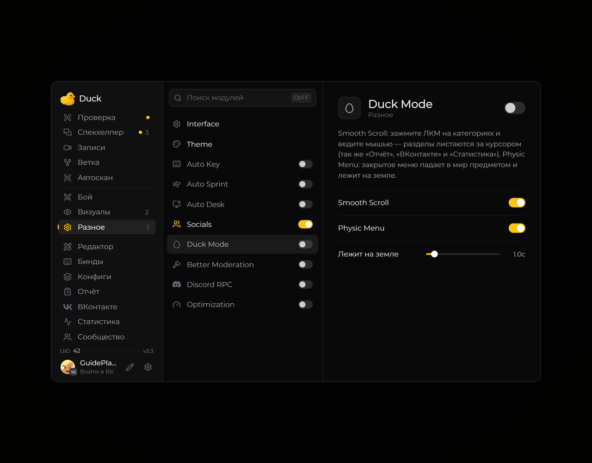

# Duck Mode — прокрутка и физика меню

**Duck Mode** в разделе **Разное** добавляет два поведения меню:

- **Smooth Scroll:** зажмите ЛКМ на разделах и ведите мышь — выбранный раздел меняется вслед за курсором. Работает также для «Отчёта», «ВКонтакте» и «Статистики».
- **Physic Menu:** после закрытия меню его плита визуально падает в игровой мир и некоторое время лежит на земле.

Оба пункта по умолчанию включены внутри модуля. **Лежит на земле** задаёт длительность плиты: **0,5–5 секунд**, по умолчанию **1 секунда**. Этот параметр виден, когда включён Physic Menu.

<!-- screenshots-3.3 -->
<figure><figcaption>
Duck Mode — режим Duck — настройки · Duck Util 3.3.
</figcaption></figure>
<!-- /screenshots-3.3 -->
