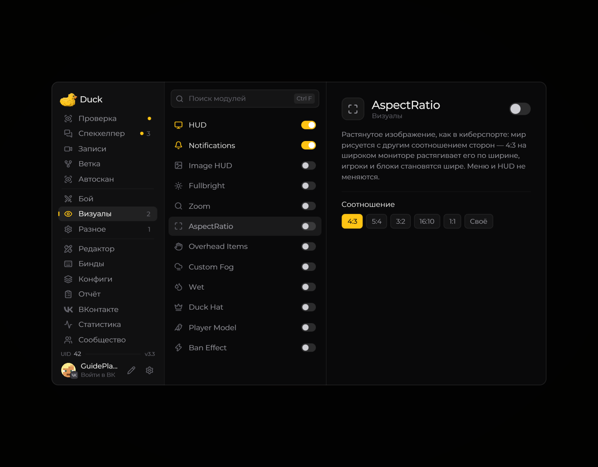

# Aspect Ratio — соотношение сторон

Модуль **Aspect Ratio** изменяет соотношение сторон игрового изображения.

<!-- screenshots-3.3 -->
<figure><figcaption>
Aspect Ratio — соотношение сторон — настройки · Duck Util 3.3.
</figcaption></figure>
<!-- /screenshots-3.3 -->

Включите модуль и выберите подходящее значение на его странице. Если изображение выглядит растянутым или обрезанным, верните настройку к исходному значению.
