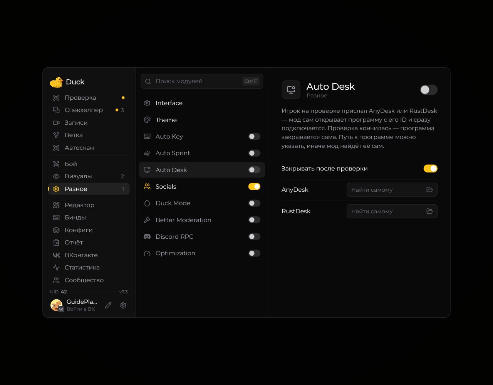

# Auto Desk — панель модерации

**Auto Desk** помогает быстрее открыть доступную на сервере панель, используемую для модерации.

<!-- screenshots-3.3 -->
<figure><figcaption>
Auto Desk — панель модерации — настройки · Duck Util 3.3.
</figcaption></figure>
<!-- /screenshots-3.3 -->

Настройте доступные параметры на странице модуля. Функция работает только при наличии соответствующего интерфейса на сервере и необходимых прав.
