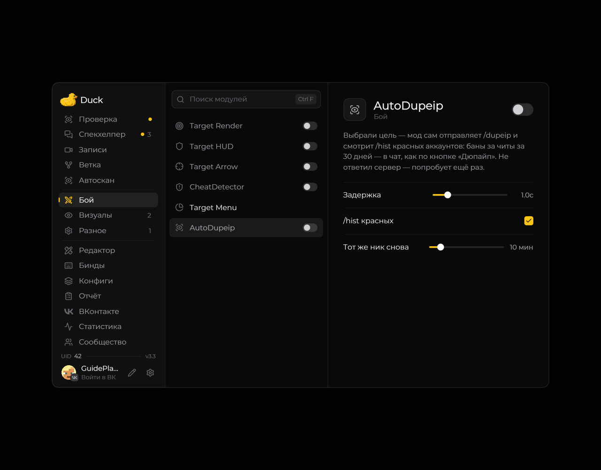

# Auto DupeIP — поиск связанных аккаунтов

Модуль **Auto DupeIP** помогает отправлять запросы поиска аккаунтов через серверные команды.

<!-- screenshots-3.3 -->
<figure><figcaption>
Auto DupeIP — поиск связанных аккаунтов — настройки · Duck Util 3.3.
</figcaption></figure>
<!-- /screenshots-3.3 -->

Откройте модуль в меню Duck Util и настройте его по подсказкам. Для работы сервер должен поддерживать поиск по IP, а ваша учётная запись — иметь необходимые права. Если запрос не выполняется, проверьте команды, доступные на сервере.
