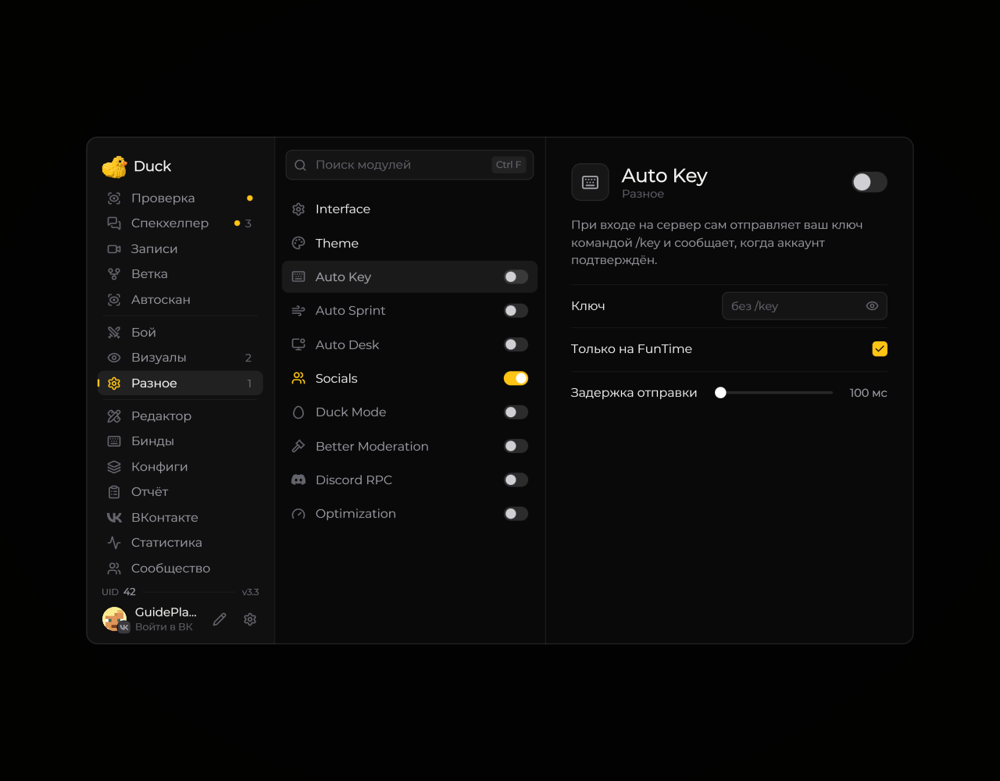

# Auto Key — автоматическое нажатие клавиши

**Auto Key** автоматизирует нажатие выбранной клавиши.

<!-- screenshots-3.3 -->
<figure><figcaption>
Auto Key — автоматическое нажатие клавиши — настройки · Duck Util 3.3.
</figcaption></figure>
<!-- /screenshots-3.3 -->

Перед использованием откройте настройки модуля и внимательно проверьте выбранную клавишу и способ активации. Отключите модуль, если он мешает управлению. На серверах автоматизация может быть запрещена правилами.
