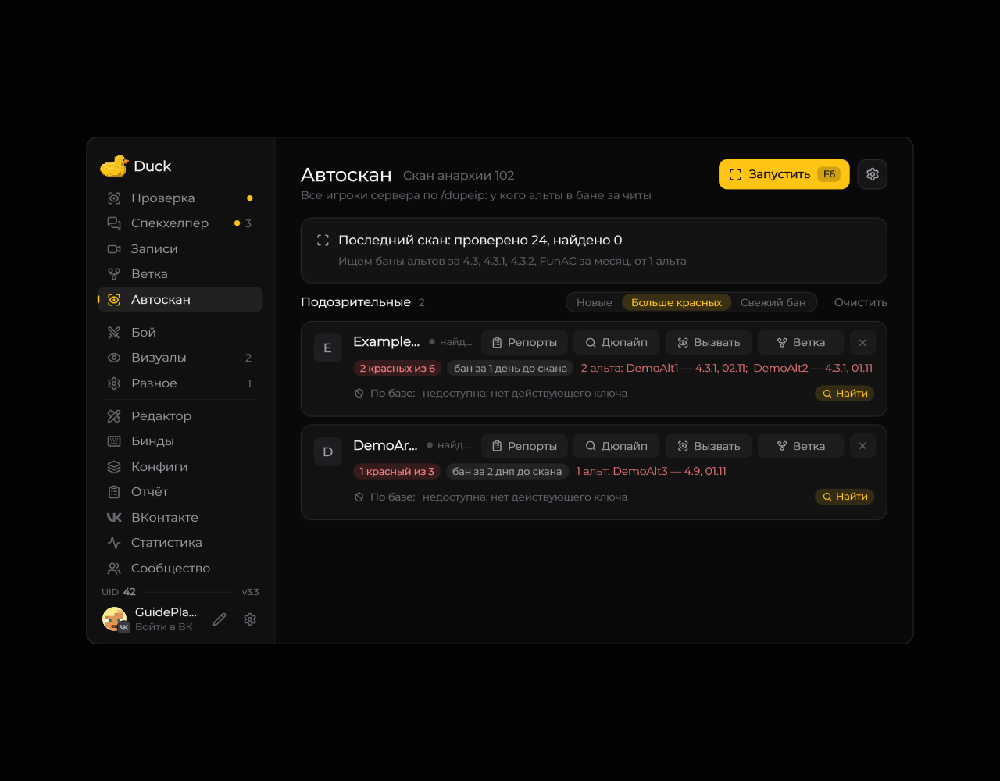
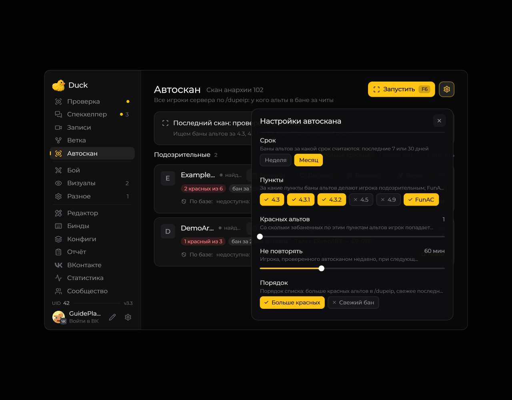

# Auto Scan — поиск игроков

**Auto Scan** помогает выполнять поиск игроков с помощью команд, которые поддерживает сервер.

<!-- screenshots-3.3 -->
<figure><figcaption>
Автоскан: результаты поиска связанных аккаунтов · Duck Util 3.3. Демонстрационные данные.
</figcaption></figure>

Параметры автоскана

<figure><figcaption>
Настройки автоскана · Duck Util 3.3. Демонстрационные данные.
</figcaption></figure>

<!-- /screenshots-3.3 -->

Откройте модуль в меню Duck Util и прочитайте подсказки у его параметров перед запуском. Если команда поиска не распознаётся, проверьте, доступна ли она на сервере и хватает ли у вашей учётной записи прав.

Управление запуском и остановкой зависит от привязок в вашей версии мода. Их можно проверить в [настройках клавиш](../nastroika/keybindings.md).
