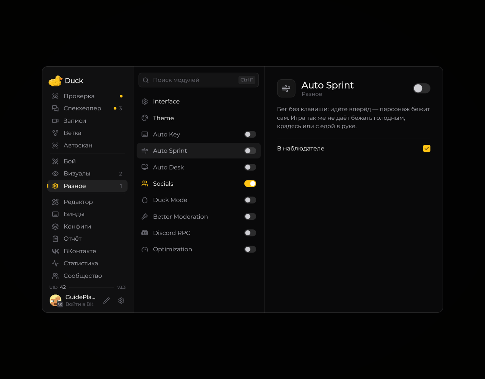

# Auto Sprint — автоматический бег

Модуль **Auto Sprint** помогает автоматически включать бег при движении.

<!-- screenshots-3.3 -->
<figure><figcaption>
Auto Sprint — автоматический бег — настройки · Duck Util 3.3.
</figcaption></figure>
<!-- /screenshots-3.3 -->

Откройте страницу модуля, чтобы включить его и настроить доступные условия. При проблемах с управлением выключите Auto Sprint. Проверьте правила сервера перед использованием.
