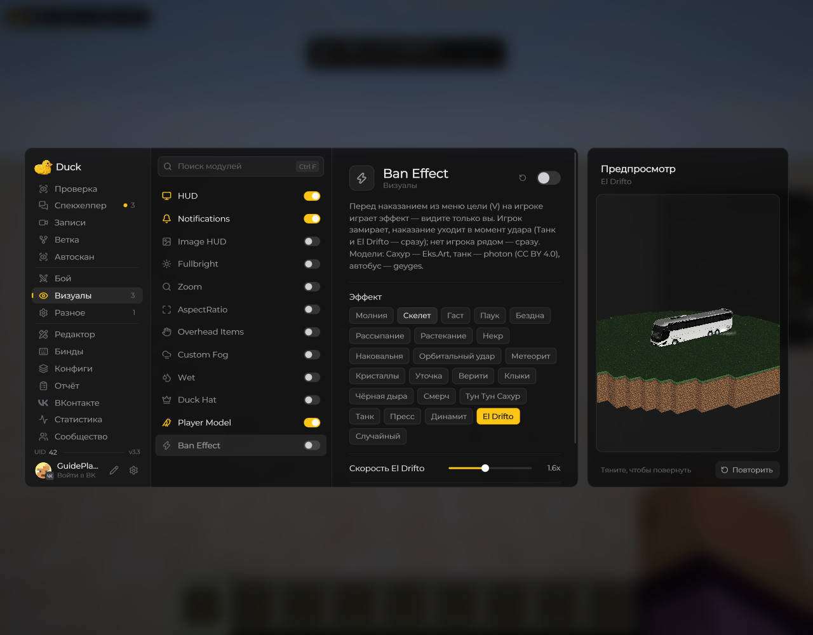
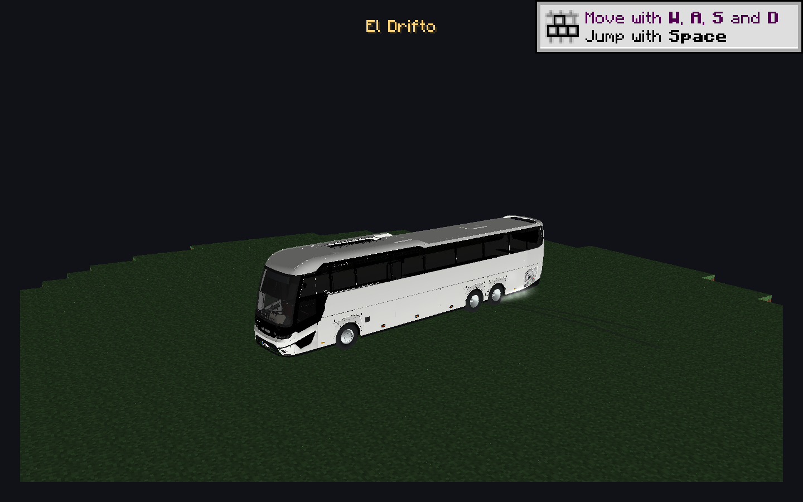
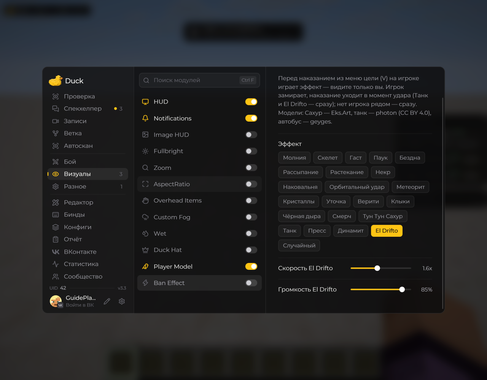

# Ban Effect — эффект бана

Модуль находится в разделе **Визуалы**. Когда вы выдаёте наказание из меню цели (**V**), выбранный эффект проигрывается на игроке рядом с вами. Если игрока рядом нет, команда отправляется сразу. Эффекты видите только вы.

<!-- screenshots-3.3 -->
<figure><figcaption>
Ban Effect — эффект бана — настройки · Duck Util 3.3.
</figcaption></figure>
<!-- /screenshots-3.3 -->

В большинстве сцен команда отправляется в момент удара. **Танк** и **El Drifto** отправляют наказание сразу: в игре остаётся замороженная копия со скином, бронёй и предметами игрока, с которой затем работает анимация.

## El Drifto

Scania появляется на расстоянии от игрока, плавно набирает скорость и заходит в занос. Под конец записи автобус сбивает копию боком и приплющивает её. Видны дым и следы шин.

<figure><figcaption>
El Drifto: Scania перед боковым ударом. Кадр из предпросмотра.
</figcaption></figure>

Высота — **3 блока**. Коллизии нет: модель не меняет блоки мира и не толкает настоящих игроков.

| Настройка | По умолчанию | Диапазон |
| --- | --- | --- |
| Скорость El Drifto | **1,6×** | 0,5–3× |
| Громкость El Drifto | **85%** | 0–100% |

Скорость меняет всю сцену. Темп записи остаётся прежним: при ускорении обрезается начало, а при замедлении полная запись включается позже. Финал звука подогнан к столкновению. **100%** воспроизводит запись с двукратным усилением относительно исходной громкости. **0%** отключает запись и звуки эффекта; дополнительно учитываются настройки звука Minecraft.

## Другие варианты

Молния, Скелет, Гаст, Паук, Бездна, Рассыпание, Растекание, Некр, Наковальня, Орбитальный удар, Метеорит, Кристаллы, Уточка, Верити, Клыки, Чёрная дыра, Смерч, Тун Тун Сахур, Танк, **Пресс**, **Динамит**.

**Пресс** придавливает игрока металлической плитой. **Динамит** показывает мигающий TNT и короткий взрыв. **Случайный** выбирает один из доступных эффектов.

У отдельных сцен есть свои настройки: скорость танка, количество ударов Сахура или прыжков уточки. Кнопка сброса возвращает настройки выбранного эффекта к значениям по умолчанию.

## Предпросмотр

В игровом мире откройте настройки Ban Effect: сцена проигрывается на модели в окне предпросмотра. Изменение скорости El Drifto перезапускает её. Звуки в предпросмотре отключены.

## Настройки El Drifto

<figure><figcaption>
Скорость и громкость El Drifto · Duck Util 3.3.
</figcaption></figure>
