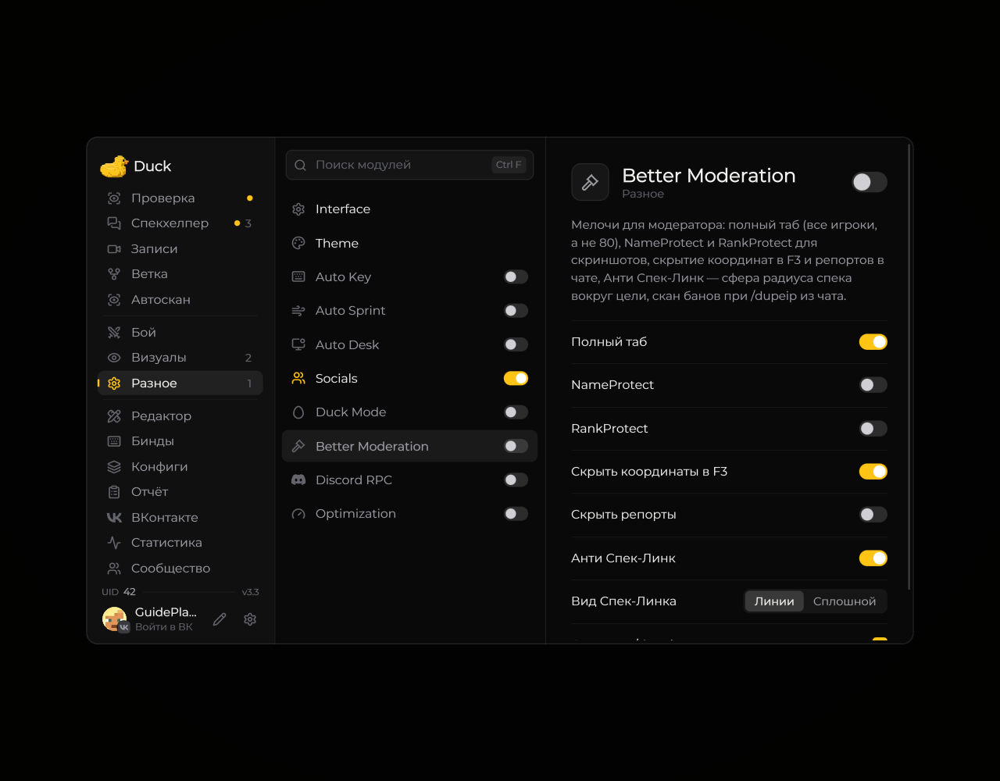

# Better Moderation — инструменты модерации

Модуль **Better Moderation** добавляет инструменты для работы с интерфейсом и сообщениями модерации.

<!-- screenshots-3.3 -->
<figure><figcaption>
Better Moderation — инструменты модерации — настройки · Duck Util 3.3.
</figcaption></figure>
<!-- /screenshots-3.3 -->

Откройте страницу модуля в меню Duck Util и используйте подсказки у доступных параметров. Некоторые действия зависят от сервера и прав вашей учётной записи. Перед отправкой команд проверьте выбранного игрока и текст действия.
