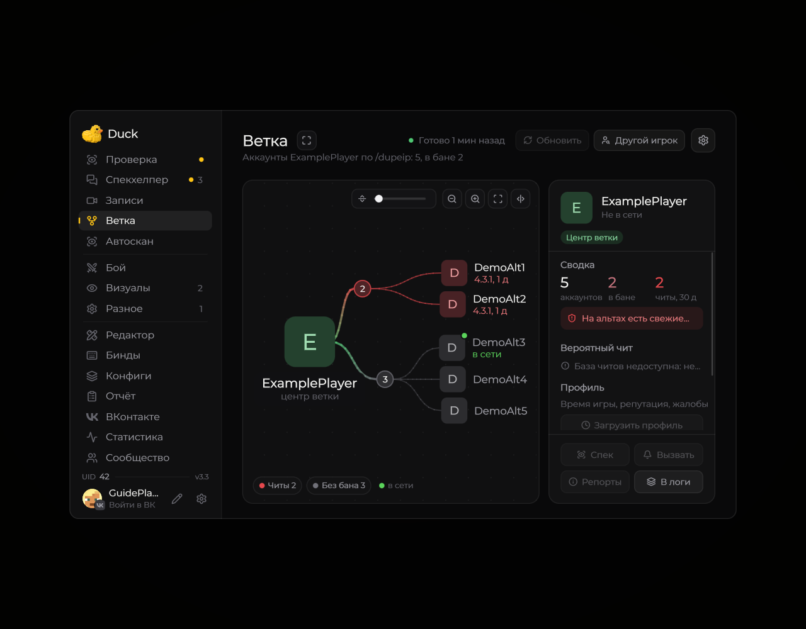
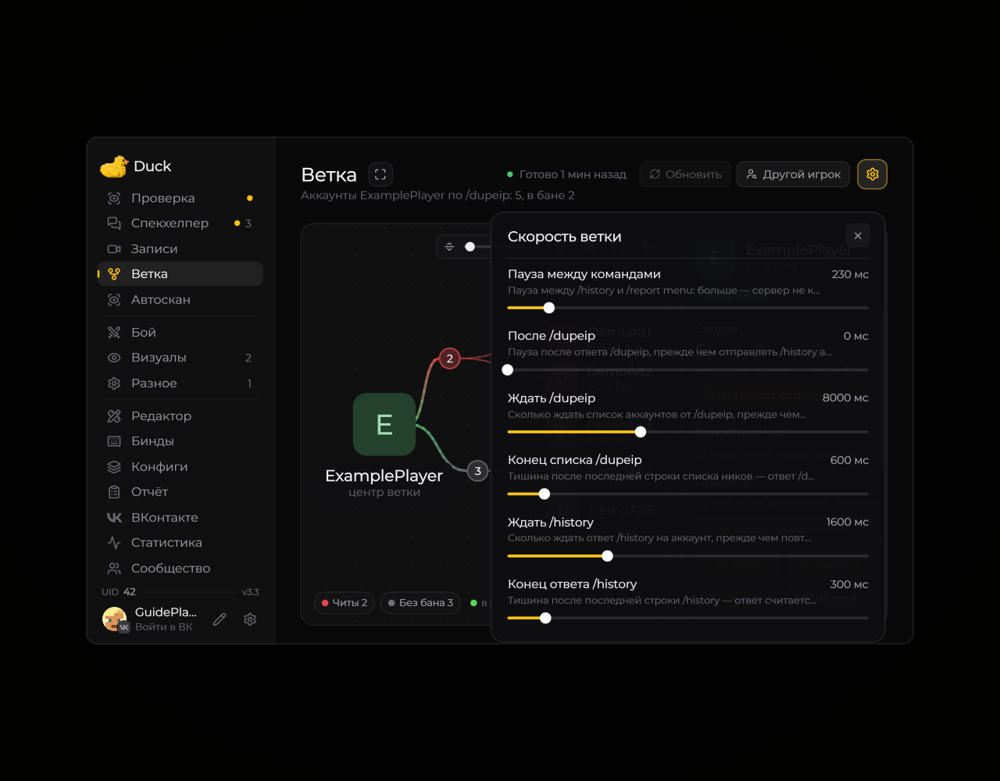

# Branch — связанные аккаунты

Модуль **Branch** показывает результаты поиска аккаунтов, связанных с выбранным игроком, если соответствующие команды доступны на сервере.

<!-- screenshots-3.3 -->
<figure><figcaption>
Ветка связанных аккаунтов · Duck Util 3.3. Демонстрационные данные.
</figcaption></figure>

Скорость запросов

<figure><figcaption>
Настройки скорости ветки · Duck Util 3.3. Демонстрационные данные.
</figcaption></figure>

<!-- /screenshots-3.3 -->

Откройте **Branch** из меню Duck Util, выберите игрока и запустите поиск. Результаты зависят от ответа сервера, ваших прав и доступных команд. Если список пуст, сначала проверьте поиск вручную на сервере.
