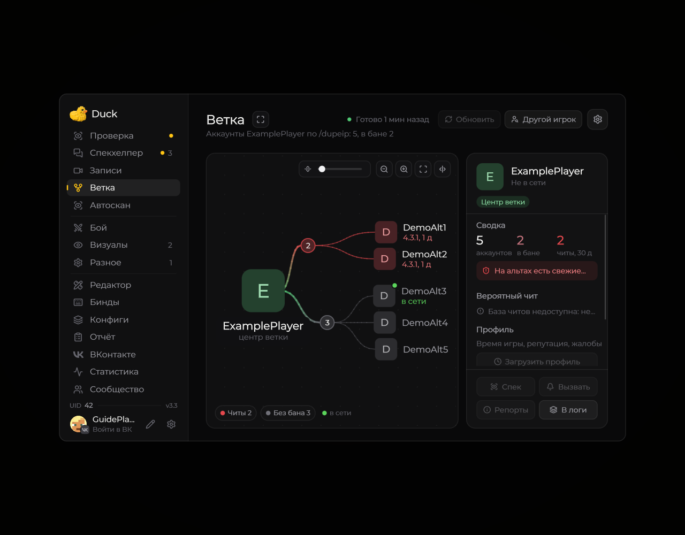

# Cheat Base — база знаний

**Cheat Base** — раздел со справочной информацией, который помогает при разборе игровых ситуаций.

<!-- screenshots-3.3 -->
<figure><figcaption>
Блок вероятного чита находится в правой карточке ветки · Duck Util 3.3. Демонстрационные данные.
</figcaption></figure>
<!-- /screenshots-3.3 -->

Откройте его страницу в меню Duck Util и используйте поиск и материалы, доступные в вашей версии. Справочная информация сама по себе не подтверждает нарушение: проверяйте ситуацию вручную и следуйте правилам сервера.
