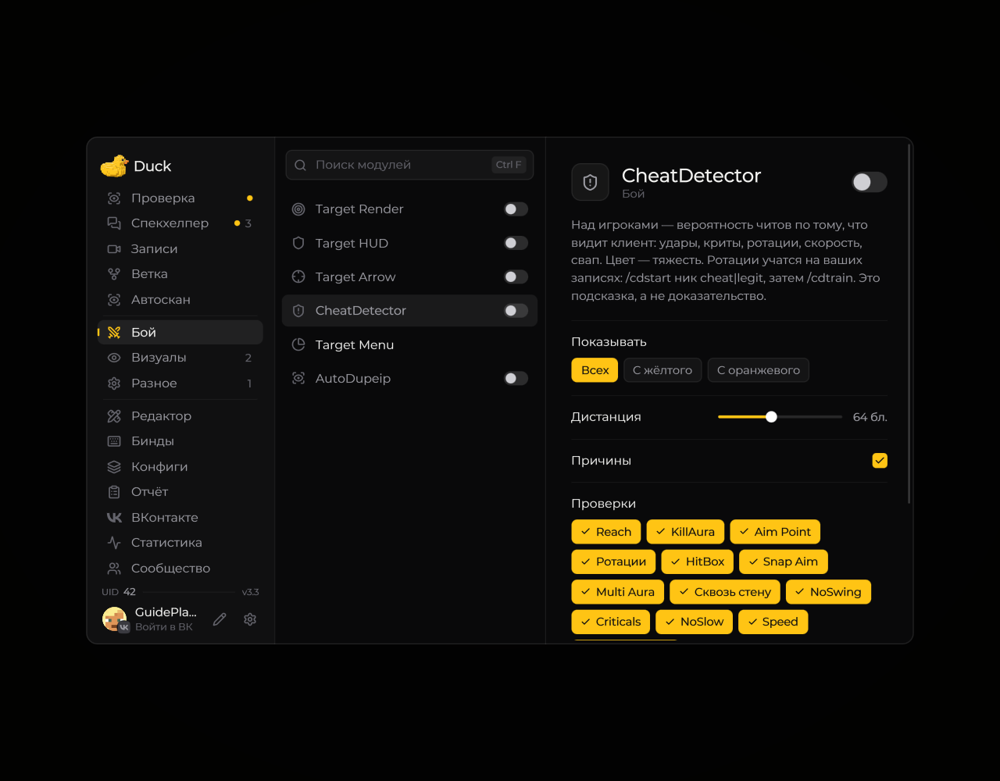

# Cheat Detector — детектор подозрительного поведения

**Cheat Detector** собирает игровые данные и отмечает подозрительные действия. Автоматические срабатывания — подсказка для проверки, а не доказательство нарушения.

<!-- screenshots-3.3 -->
<figure><figcaption>
Cheat Detector — детектор подозрительного поведения — настройки · Duck Util 3.3.
</figcaption></figure>
<!-- /screenshots-3.3 -->

Настройте модуль в меню Duck Util. Если вам нужна запись для последующего разбора, используйте встроенные команды:

* `/cdstart ник` — начать запись для игрока;
* `/cdstart me` — записать ваши действия;
* `/cdstart all` — записать действия игроков поблизости;
* `/cdstop` — завершить запись.

Команды доступны при активной лицензии. Используйте записи ответственно и соблюдайте правила сервера и требования к приватности.
