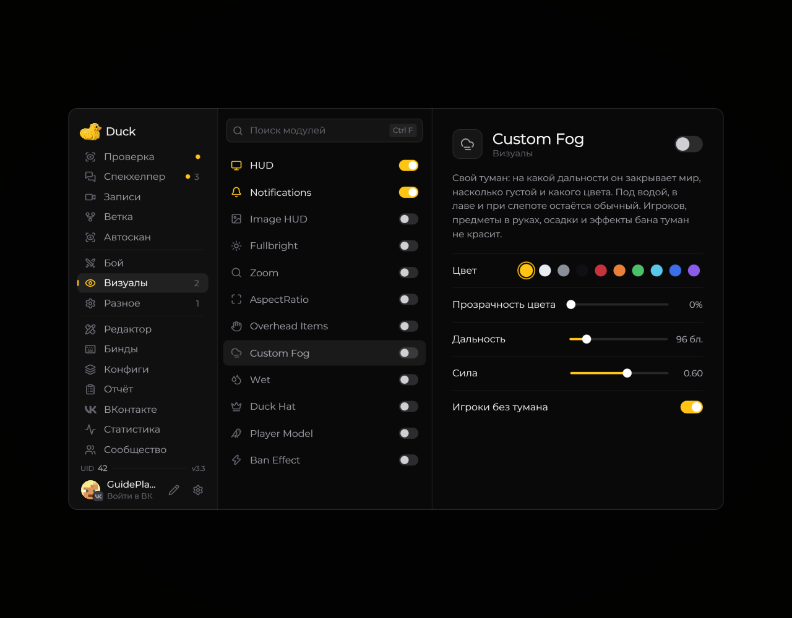

# Custom Fog — туман

**Custom Fog** позволяет менять отображение тумана в игровом мире.

<!-- screenshots-3.3 -->
<figure><figcaption>
Custom Fog — туман — настройки · Duck Util 3.3.
</figcaption></figure>
<!-- /screenshots-3.3 -->

Включите модуль и настройте доступные параметры на его странице. Если туман выглядит не так, как ожидалось, выключите модуль или сбросьте его настройки.
