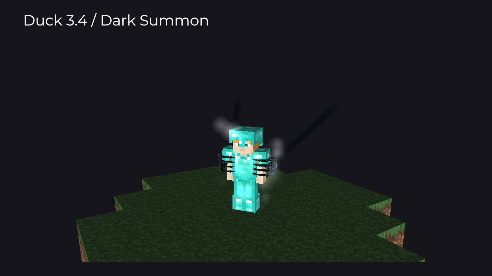
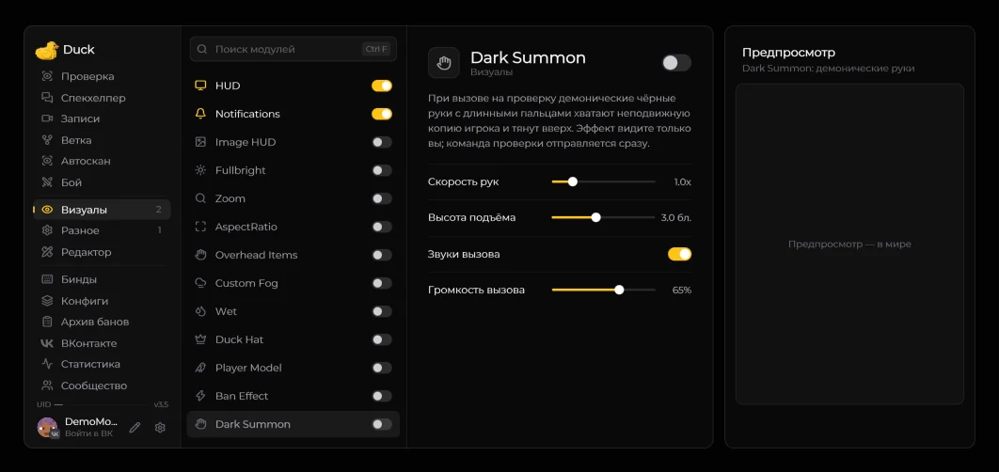

# Dark Summon — вызов на проверку

Модуль доступен после включения [**Old (revise)**](interface.md). В предпросмотре в игровом мире можно повторить захват и подъём. Изменение скорости или высоты запускает сцену заново.

Модуль находится в **Визуалах**. При вызове игрока на проверку из меню цели демонические чёрные руки медленно опускаются, обхватывают неподвижную копию по бокам, смыкают пальцы и после короткой фиксации резко поднимают её вверх.

<figure><figcaption>
Боковой захват Dark Summon. Демонстрационная сцена 3.4.
</figcaption></figure>

## Включение

1. Включите **Right Shift → Разное → Interface → Меню → Old (revise)**.
2. Откройте **Визуалы → Dark Summon**, включите модуль и задайте скорость и высоту подъёма.
3. Откройте меню цели клавишей **V** и выберите **«Вызвать на проверку»**.

**Команда проверки отправляется сразу**, без ожидания анимации. Сцена видна только вам и работает с копией: настоящего игрока она не перемещает. Если цель не загружена в мире, вызов выполняется без визуальной сцены.

## Настройки

| Параметр         | По умолчанию | Диапазон                   |
| ---------------- | ------------ | -------------------------- |
| Скорость рук     | 1×           | 0,5–3×                     |
| Высота подъёма   | 3 блока      | 1,5–5 блоков               |
| Звуки вызова     | Включено     | Гул, захват и звук подъёма |
| Громкость вызова | 65%          | 0–100%                     |

Громкость показывается при включённых звуках вызова. Захват учитывает поворот копии, обычный или тонкий скин и броню: пальцы ложатся спереди, большие пальцы удерживают сзади.

Dark Summon отвечает за **вызов**, а [Ban Effect](ban-effect.md) — за **наказание**. Если во время вызова выдать бан-эффект, он заменит сцену вызова для этого игрока.
