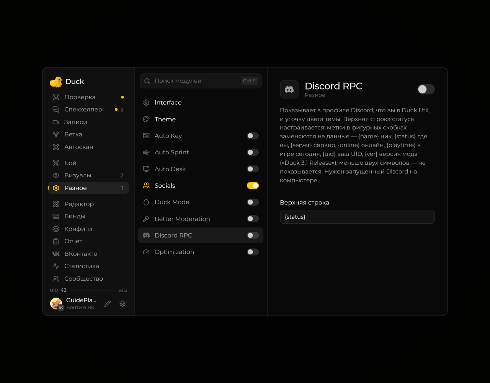

# Discord RPC — статус Discord

Модуль **Discord RPC** может показывать статус Duck Util в Discord.

<!-- screenshots-3.3 -->
<figure><figcaption>
Discord RPC — статус Discord — настройки · Duck Util 3.3.
</figcaption></figure>
<!-- /screenshots-3.3 -->

Включите модуль, если хотите отображать игровую активность. Для работы потребуется запущенный Discord. Какие сведения видны другим пользователям, зависит от настроек приватности Discord.
