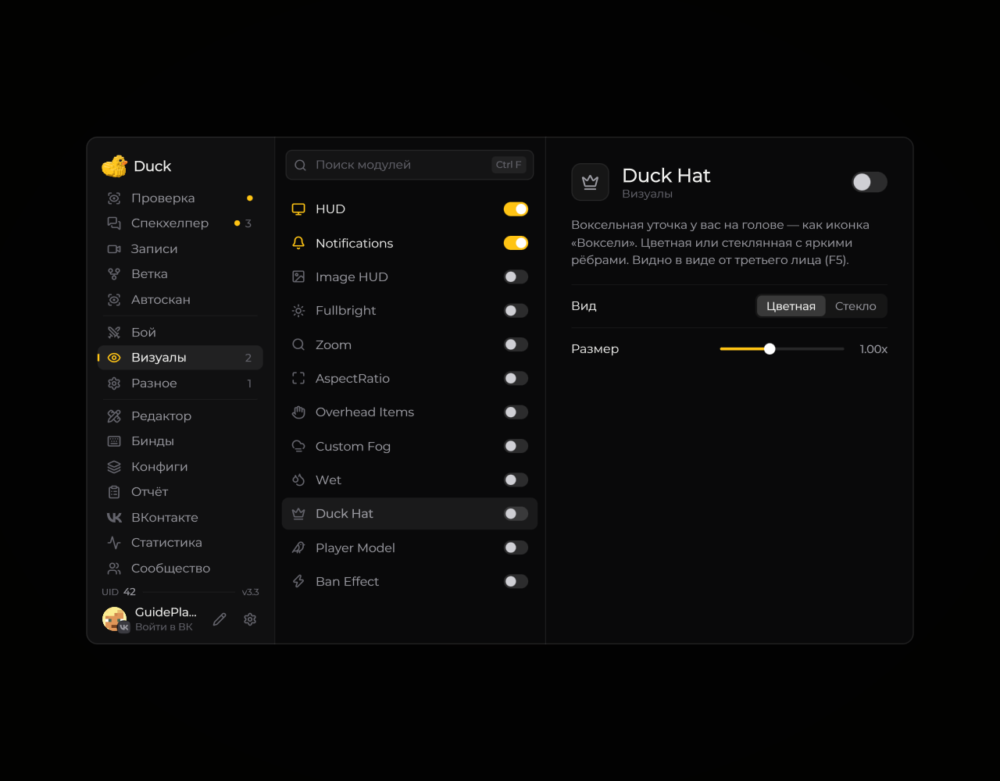
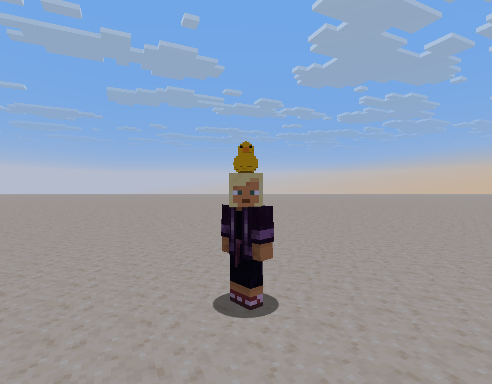

# Duck Hat — шляпа утки

**Duck Hat** добавляет декоративную шляпу в форме утки на модель игрока.

<!-- screenshots-3.3 -->
<figure><figcaption>
Duck Hat — шляпа утки — настройки · Duck Util 3.3.
</figcaption></figure>
<!-- /screenshots-3.3 -->

Откройте страницу модуля, чтобы включить шляпу и настроить доступные параметры. Видимость косметических эффектов для других игроков зависит от того, что показывает их клиент и сервер.

## В игре

<figure><figcaption>
Duck Hat в виде от третьего лица · Duck Util 3.3.
</figcaption></figure>
