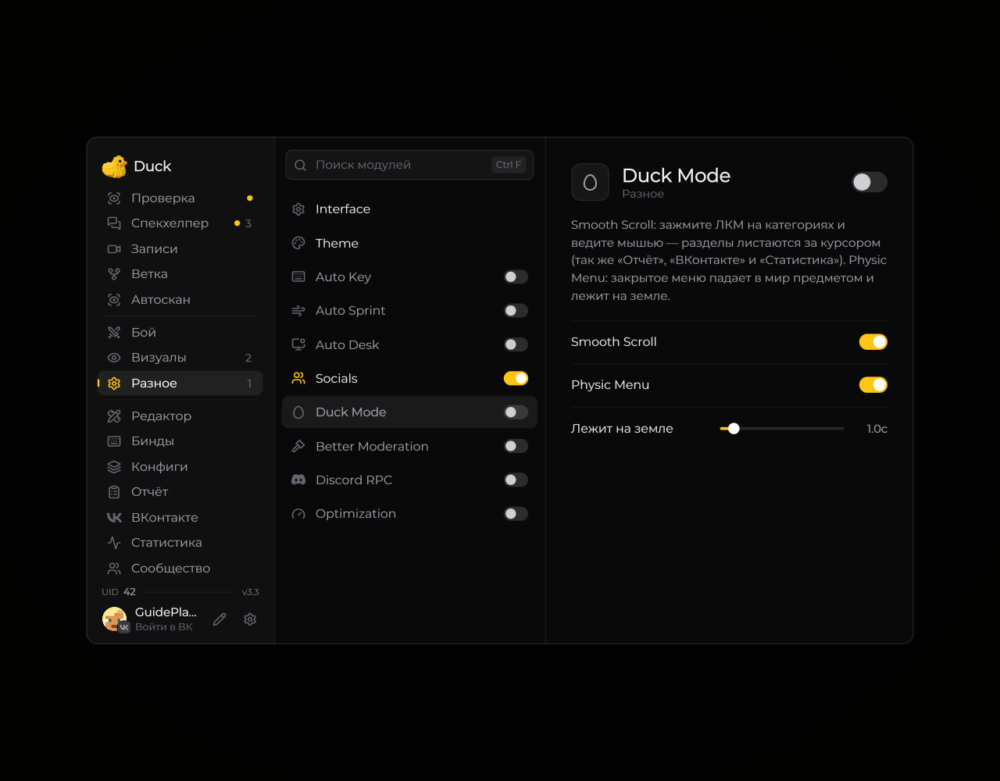

# Duck Mode — режим Duck

**Duck Mode** включает тематические визуальные элементы Duck Util. Откройте страницу модуля и настройте доступные эффекты по своему вкусу.

<!-- screenshots-3.3 -->
<figure><figcaption>
Duck Mode — режим Duck — настройки · Duck Util 3.3.
</figcaption></figure>
<!-- /screenshots-3.3 -->