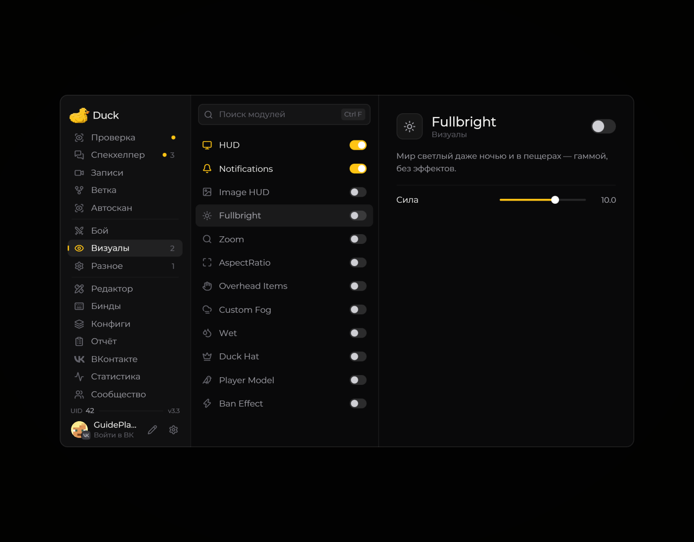

# Fullbright — яркость

**Fullbright** меняет отображение тёмных областей игрового мира. Включите модуль и настройте доступную яркость в его параметрах.

<!-- screenshots-3.3 -->
<figure><figcaption>
Fullbright — яркость — настройки · Duck Util 3.3.
</figcaption></figure>
<!-- /screenshots-3.3 -->

Правила некоторых серверов ограничивают использование таких визуальных модулей. Перед включением проверьте правила сервера.
