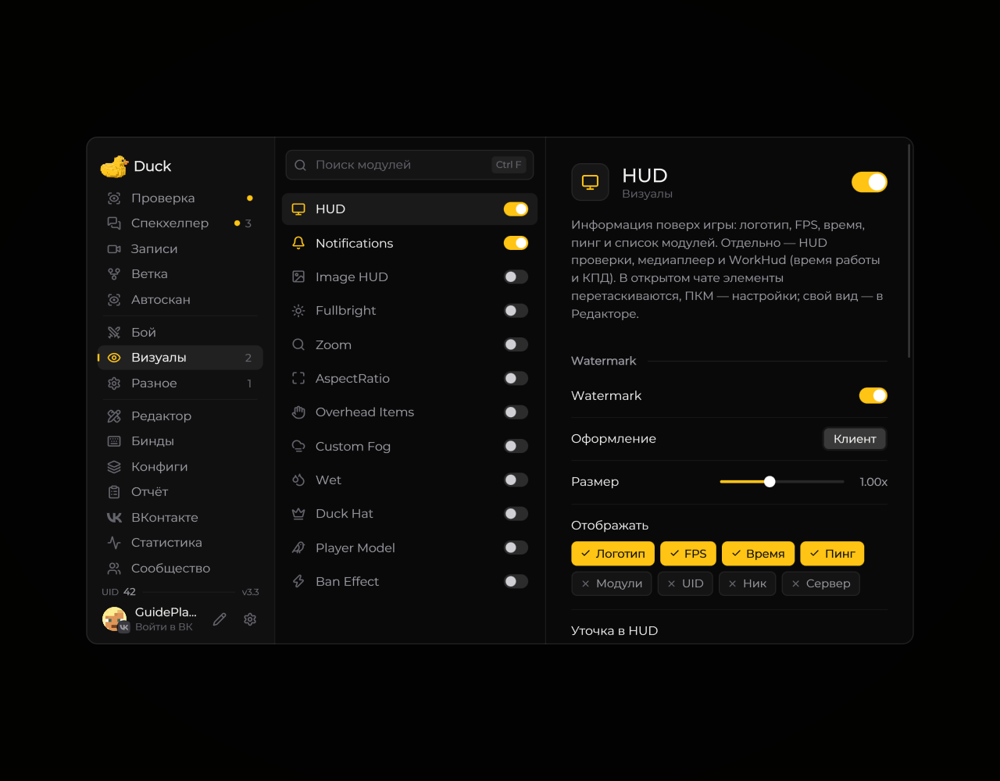

# HUD — элементы экрана

Модуль **HUD** управляет дополнительными элементами, которые Duck Util показывает поверх игры. В зависимости от версии и настроек это могут быть сведения о цели, координаты, FPS или информация о медиаплеере.

<!-- screenshots-3.3 -->
<figure><figcaption>
HUD — элементы экрана — настройки · Duck Util 3.3.
</figcaption></figure>
<!-- /screenshots-3.3 -->

Включайте только нужные элементы. Чтобы изменить их расположение, воспользуйтесь [редактором HUD](../nastroika/hud-editor.md). Если элемент не появляется, проверьте его настройки и наличие активной лицензии.
