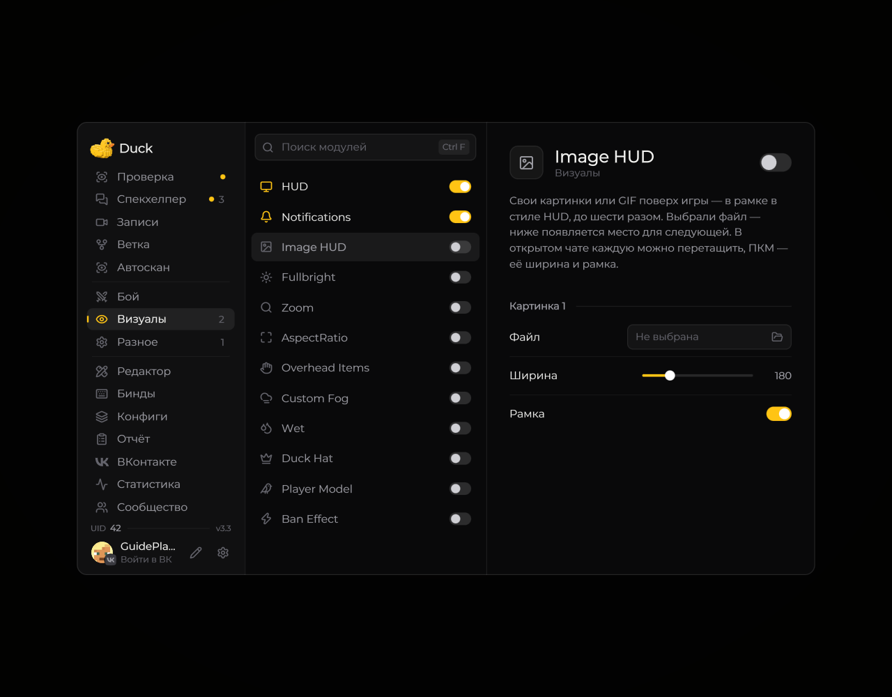

# Image HUD — изображения на экране

**Image HUD** позволяет разместить своё изображение поверх игрового экрана.

<!-- screenshots-3.3 -->
<figure><figcaption>
Image HUD — изображения на экране — настройки · Duck Util 3.3.
</figcaption></figure>
<!-- /screenshots-3.3 -->

Откройте страницу **Image HUD** в меню Duck Util. Выберите изображение и настройте его положение и размер доступными параметрами. Поддерживаемые форматы и пределы размера отображаются в меню мода.

Если изображение не появляется, проверьте, что файл доступен и модуль включён.
