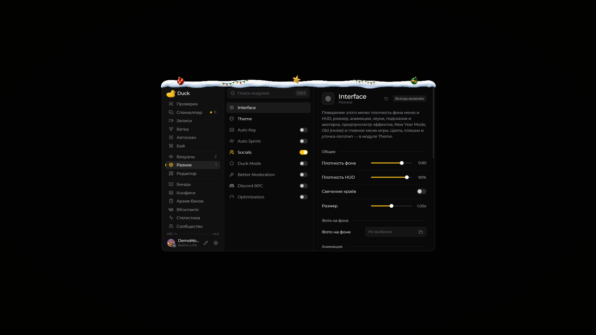

# Interface — оформление меню

Модуль **Interface** содержит настройки внешнего вида меню Duck Util: фон, масштаб, прозрачность, анимации и звуки.

<figure><figcaption>
Interface · Duck Util 4.0. New Year Mode включён.
</figcaption></figure>

Откройте меню клавишей **Right Shift**, выберите **Interface** и меняйте параметры, чтобы сразу увидеть результат. Если надписи плохо читаются, уменьшите прозрачность фона или отключите изображение под меню.

Для выбора цветовой схемы откройте модуль [Theme](theme.md).

## Old (revise) · 4.0

Откройте **Right Shift → Разное → Interface** и прокрутите до раздела **«Меню»**. Переключатель **Old (revise)** по умолчанию выключен и сохраняется в конфиге.

При включении в боковом меню появляется страница [«Проверка»](../nastroika/check-screen.md). В меню цели на **V** появляется **«Вызвать на проверку»**, а в **«Визуалах»** можно включить [Dark Summon](dark-summon.md). [Спекхелпер смены](../nastroika/spec-helper.md) доступен при обоих положениях переключателя.

Автоскан всего сервера и система отчётов полностью удалены из 4.1 и не возвращаются при включении Old (revise).

## New Year Mode · 4.0

Включите **Right Shift → Разное → Interface → New Year Mode** в разделе **«Меню»**. По умолчанию режим выключен; его можно включать в любое время года.

На снегу расположены **красные и изумрудные шары**, **золотые звёзды** и **небольшие участки гирлянды с цветными лампочками**. На широких окнах — три игрушки и две гирлянды; на узких — две игрушки и одна гирлянда. Гирлянды расположены на разной высоте и под разными углами. Шары и звёзды тоже развёрнуты и немного различаются по размеру; на нижней стороне каждой игрушки лежит свой снежный налёт. Он повторяет изгиб шара или грани звезды: у снега неровная кромка, небольшие комочки и мягкая тень у поверхности. В круглом меню украшения следуют изгибу рамки.

Текстуры сгенерированы в высоком разрешении с настоящей прозрачностью. При уменьшении мод подготавливает подходящий размер со сглаживанием краёв и сохраняет пропорции спрайтов. Украшения включаются и выключаются вместе с New Year Mode.

Объёмная снежная шапка украшает верхнюю кромку меню, окна предпросмотра, диалогов и полноэкранной «Ветки». В круглом меню цели снег повторяет изгиб кольца. Снег опущен плотнее на раму, чтобы закрывать верхние углы и не оставлять просвет над окном. Шапка масштабируется вместе с GUI и не закрывает заголовки и кнопки.

**HUD остаётся без новогодних украшений**: рабочий чат, watermark, уведомления и остальные элементы экрана сохраняют своё оформление. Переключатель сохраняется в конфиге.

<figure><figcaption>
Меню и предпросмотр · New Year Mode, Duck Util 4.0.
</figcaption></figure>
