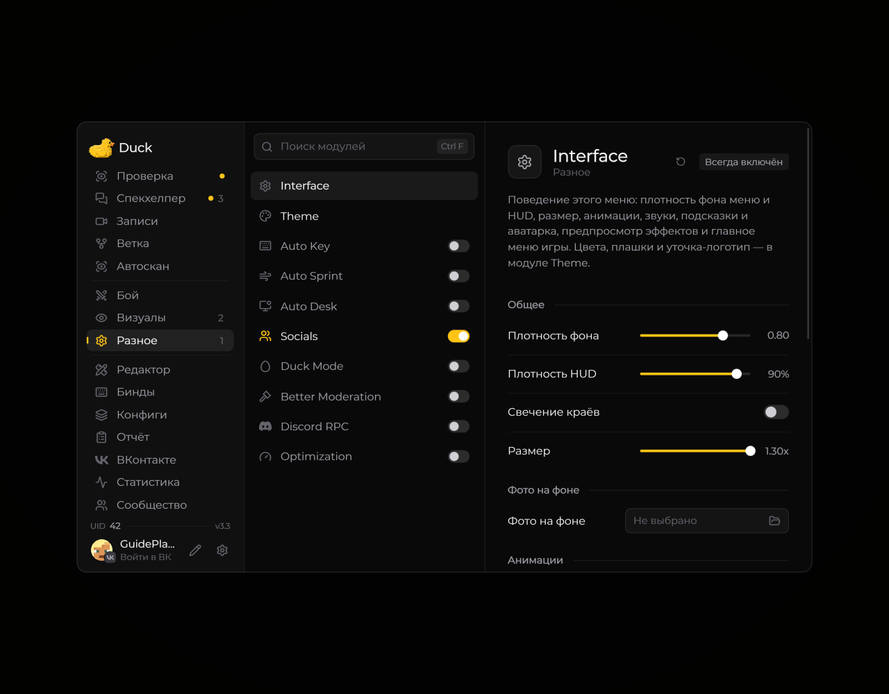
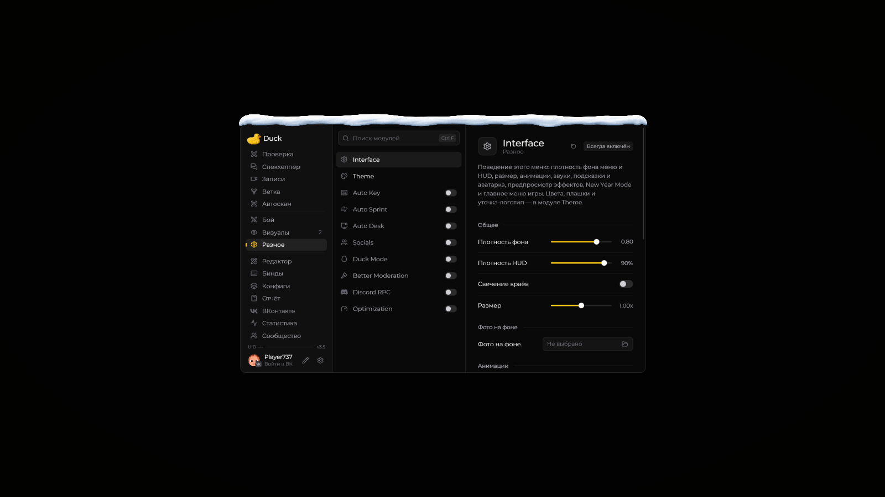

# Interface — оформление меню

Модуль **Interface** содержит настройки внешнего вида меню Duck Util: фон, масштаб, прозрачность, анимации и звуки.

<figure><figcaption>
Interface — оформление меню — настройки · Duck Util 3.3.
</figcaption></figure>

Откройте меню клавишей **Right Shift**, выберите **Interface** и меняйте параметры, чтобы сразу увидеть результат. Если надписи плохо читаются, уменьшите прозрачность фона или отключите изображение под меню.

Для выбора цветовой схемы откройте модуль [Theme](theme.md).

## New Year Mode · 3.5

Включите **Right Shift → Разное → Interface → New Year Mode** в разделе **«Меню»**. По умолчанию режим выключен; его можно включать в любое время года.

Объёмная снежная шапка украшает верхнюю кромку меню, окна предпросмотра, диалогов и полноэкранной «Ветки». В круглом меню цели снег повторяет изгиб кольца. Шапка масштабируется вместе с GUI и не закрывает заголовки и кнопки.

**HUD остаётся без снега**: рабочий чат, watermark, уведомления и остальные элементы экрана сохраняют своё оформление. Переключатель сохраняется в конфиге.

<figure><figcaption>
New Year Mode · Duck Util 3.5. Снимок меню из отдельного тестового клиента.
</figcaption></figure>
