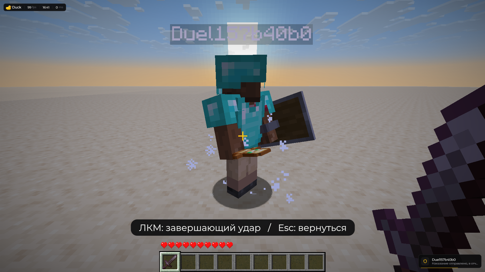

# Последняя дуэль

Это вариант [Ban Effect](ban-effect.md). **Бан выполняется сразу.** В мире остаётся локальная неподвижная копия со скином, бронёй и предметами игрока; завершающий удар относится только к ней.

<figure><figcaption>
Последняя дуэль в 3.4. Тестовый игрок в отдельном мире; настоящий бан не выполнялся.
</figcaption></figure>

## Как запустить

1. Откройте **Right Shift → Визуалы → Ban Effect** и включите модуль.
2. Выберите **Последняя дуэль** и нужное **Время на удар**.
3. В игровом мире откройте меню цели клавишей **V** и выдайте наказание.
4. После закрытия меню появятся меч, хотбар и отдельный вид от первого лица.
5. Подойдите к копии и нажмите **ЛКМ**. Для попадания нужны близкая дистанция и прямая видимость.

Работают обычное, компактное и круговое меню цели. В версии **3.4** исправлено преждевременное завершение сцены во время анимации закрытия меню. Если игрок не загружен в вашем мире, наказание отправится без эффекта.

## Камера и движение

Мышь вращает отдельную камеру, клавиши движения перемещают её, пробел позволяет подпрыгнуть. **Настоящие положение, поворот, режим, выбранный слот и инвентарь остаются прежними.** Меч и хотбар существуют только в сцене.

Камера проходит через стены. Если она стартует внутри блока или оказывается над пустотой, появляется виртуальная платформа. После выхода к обычной земле опора исчезает. Она не ставит блоки в игровой мир.

Поддерживаются настоящий spectator и серверный `/spec`, реализованный без него. Движения, взаимодействия и взмахи сцены на сервер не отправляются; исходная команда наказания не повторяется при ударе.

## Настройки

| Параметр          | По умолчанию | Что меняет                              |
| ----------------- | ------------ | --------------------------------------- |
| Время на удар     | 12 секунд    | 3–30 секунд ожидания завершающего удара |
| Дуэль в случайных | Выключено    | Разрешает сцену в варианте «Случайный»  |

## Возврат и отмена

После завершающего удара камера возвращается в исходную точку и ракурс. Если не ударить за выбранное время, она также вернётся.

**Esc**, открытие другого экрана, выход из мира, выключение Ban Effect, реальный телепорт или смена режима сервером отменяют сцену. При серверном телепорте сохраняется новое положение, назначенное сервером.

В окне предпросмотра дуэль проигрывается без захвата вашей камеры. Разбор остальных неполадок — [частые проблемы](../reshenie-problem/common-issues.md).
