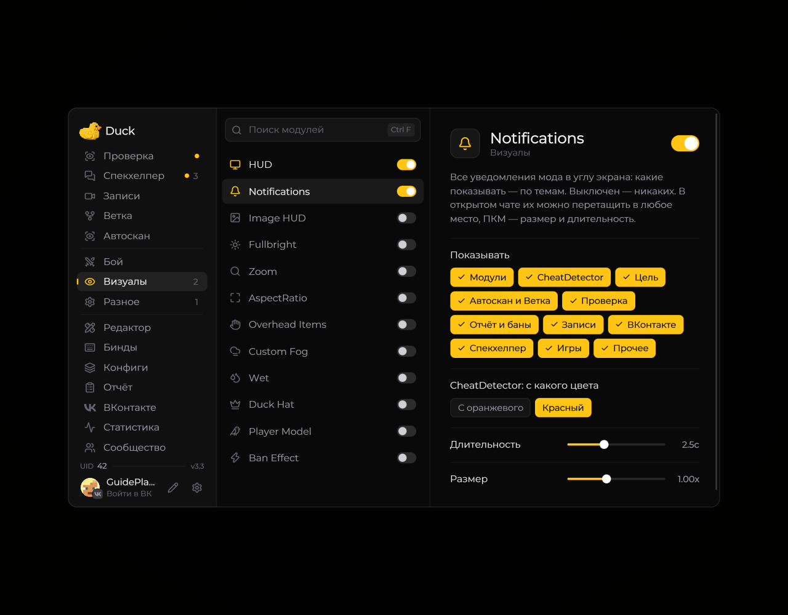

# Notifications — уведомления

**Notifications** отвечает за уведомления Duck Util о событиях мода.

<!-- screenshots-3.3 -->
<figure><figcaption>
Notifications — уведомления — настройки · Duck Util 3.3.
</figcaption></figure>
<!-- /screenshots-3.3 -->

Если уведомления отвлекают, откройте страницу **Notifications** и настройте доступные параметры. Состав настроек зависит от установленной версии.
