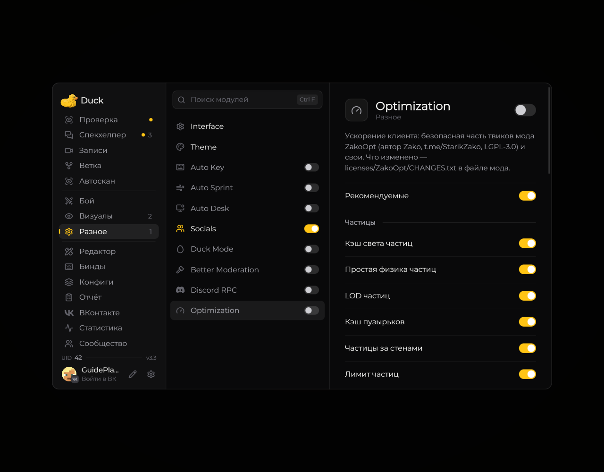

# Optimization — оптимизация

Модуль **Optimization** включает доступные в Duck Util параметры производительности. Состав переключателей может отличаться в разных версиях мода.

<!-- screenshots-3.3 -->
<figure><figcaption>
Optimization — оптимизация — настройки · Duck Util 3.3.
</figcaption></figure>
<!-- /screenshots-3.3 -->

Откройте меню клавишей **Right Shift**, выберите **Optimization** и включайте настройки по одной. Если появились графические артефакты или снизилась производительность, верните последнюю настройку в исходное состояние.

Доступность модуля без активной лицензии зависит от текущей версии Duck Util.
