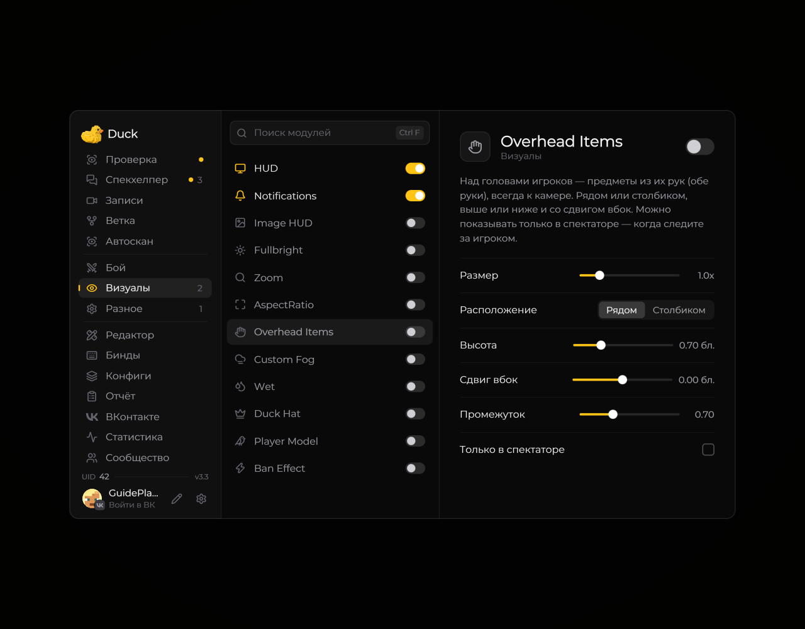

# Overhead Items — предметы над игроками

**Overhead Items** показывает предметы, которые держат игроки, над их персонажами.

<!-- screenshots-3.3 -->
<figure><figcaption>
Overhead Items — предметы над игроками — настройки · Duck Util 3.3.
</figcaption></figure>
<!-- /screenshots-3.3 -->

Настройте отображение и расстояние на странице модуля. Доступность сведений зависит от того, какую информацию передаёт сервер. Учитывайте правила сервера перед включением.
