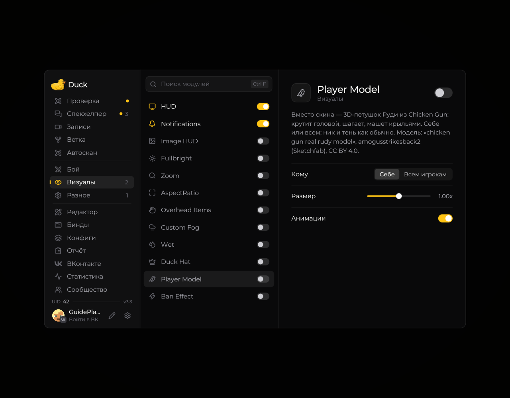
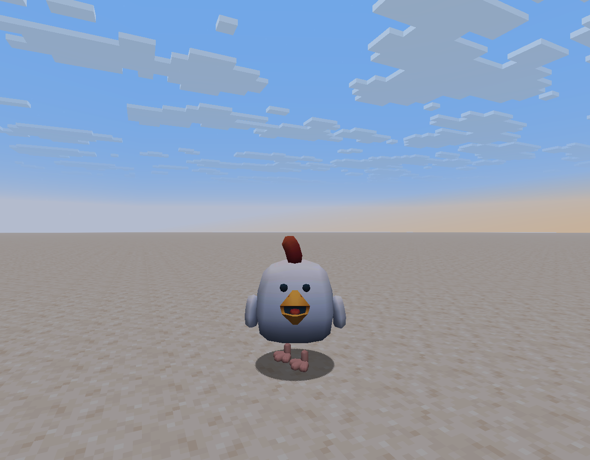

# Player Model — модель игрока

Модуль **Player Model** меняет внешний вид модели игрока доступными в Duck Util вариантами.

<!-- screenshots-3.3 -->
<figure><figcaption>
Player Model — модель игрока — настройки · Duck Util 3.3.
</figcaption></figure>
<!-- /screenshots-3.3 -->

Откройте страницу модуля и выберите нужный вариант. Если модель отображается некорректно, верните стандартный вариант и проверьте, повторяется ли проблема.

## В игре

<figure><figcaption>
Модель Руди вместо скина игрока · Duck Util 3.3.
</figcaption></figure>
