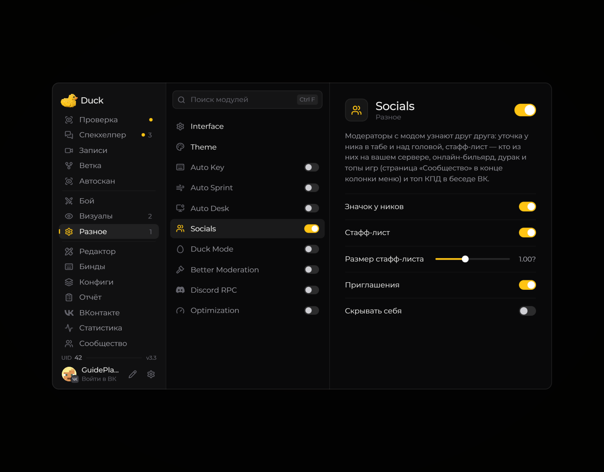

# Socials — социальные функции

Модуль **Socials** управляет социальными возможностями Duck Util. Откройте страницу модуля и включите нужные функции.

<!-- screenshots-3.3 -->
<figure><figcaption>
Socials — социальные функции — настройки · Duck Util 3.3.
</figcaption></figure>
<!-- /screenshots-3.3 -->

Для сетевых разделов может понадобиться интернет и активная лицензия. Если данные не появляются, проверьте подсказки в меню и повторите попытку позже.
