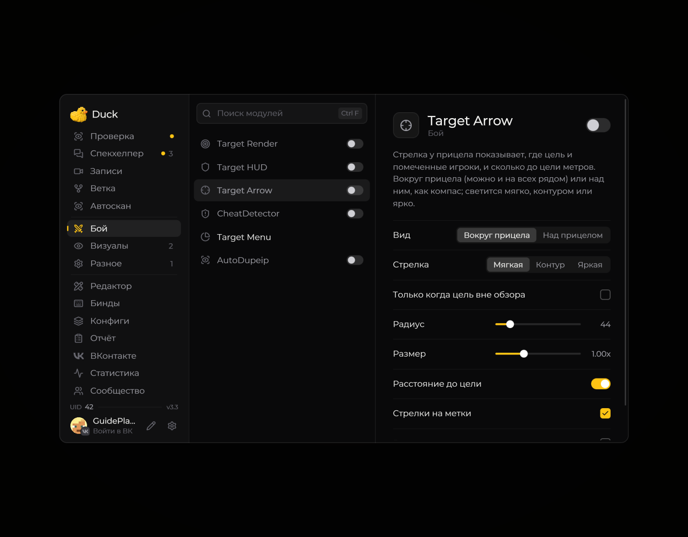

# Target Arrow — указатель цели

**Target Arrow** показывает направление к выбранной цели.

<!-- screenshots-3.3 -->
<figure><figcaption>
Target Arrow — указатель цели — настройки · Duck Util 3.3.
</figcaption></figure>
<!-- /screenshots-3.3 -->

Включите модуль на его странице в меню Duck Util. Чтобы указатель работал, сначала выберите цель через игровое меню цели, которое открывается клавишей **V**.
