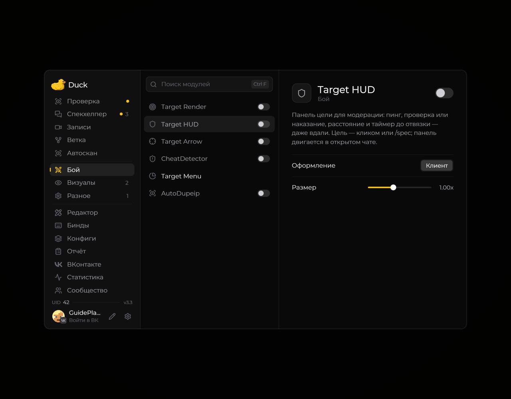

# Target HUD — панель цели

**Target HUD** показывает панель с доступной информацией о выбранной цели.

<!-- screenshots-3.3 -->
<figure><figcaption>
Target HUD — панель цели — настройки · Duck Util 3.3.
</figcaption></figure>
<!-- /screenshots-3.3 -->

Чтобы панель появилась, выберите цель и включите модуль. Настройте расположение и отображаемые сведения на странице **Target HUD**. Если цель не отображается, проверьте настройки цели и что вы находитесь в игровом мире.
