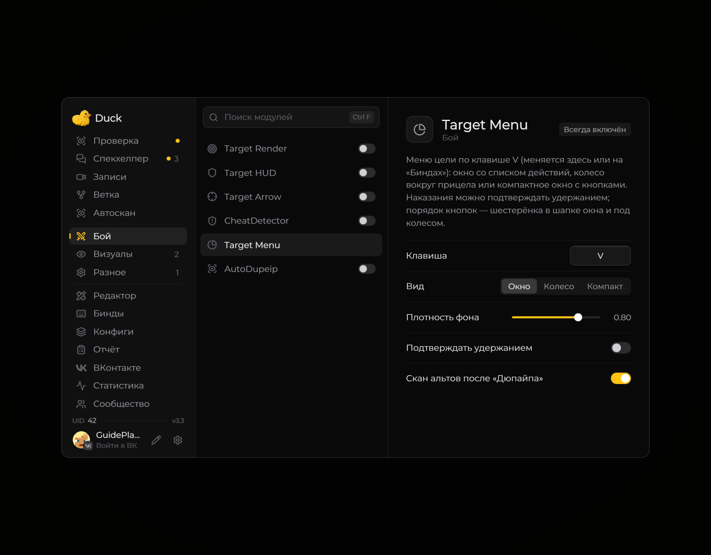

# Target Menu — действия с целью

Меню цели открывается клавишей **V** в игровом мире. Если рядом есть игроки или уже выбрана цель, откроется меню доступных действий.

<figure><figcaption>
Target Menu — действия с целью — настройки · Duck Util 3.3.
</figcaption></figure>

Проверьте имя игрока и действие перед выбором. Список действий зависит от версии Duck Util и возможностей сервера; мод не выдаёт дополнительные права на сервере.

## Список меток · 4.0

В виде **«Окно»** список меток слева прокручивается колесом или перетаскиванием ползунка. Записи после десятой доступны без удаления других меток. **ЛКМ** по нику открывает действия игрока, **ПКМ** снимает его метку. Ползунок появляется автоматически, если список длиннее окна.

[Управление списком и актуальные снимки](../nastroika/target-menu-ui.md).
