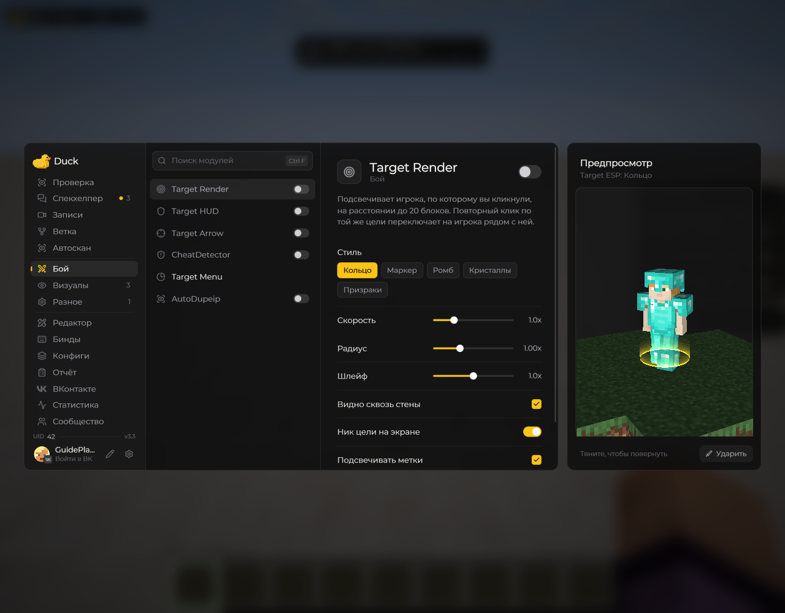

# Target Render — отображение цели

**Target Render** отвечает за визуальное отображение выбранной цели в игровом мире.

<!-- screenshots-3.3 -->
<figure><figcaption>
Target Render — отображение цели — настройки · Duck Util 3.3.
</figcaption></figure>
<!-- /screenshots-3.3 -->

Откройте страницу модуля и настройте нужные способы отображения. Для выбора цели используйте [меню цели](target-menu.md). На некоторых серверах отдельные визуальные функции могут быть запрещены — соблюдайте правила сервера.
