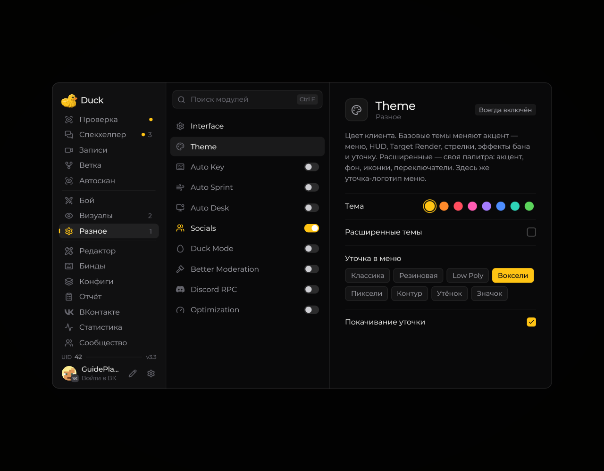

# Theme — темы

Модуль **Theme** меняет цветовое оформление Duck Util.

<!-- screenshots-3.3 -->
<figure><figcaption>
Theme — темы — настройки · Duck Util 3.3.
</figcaption></figure>
<!-- /screenshots-3.3 -->

Откройте страницу **Theme** из меню мода, чтобы выбрать готовую тему или изменить доступные цвета. Настройки оформления можно вернуть к исходным с помощью кнопки сброса на странице, если она доступна.
