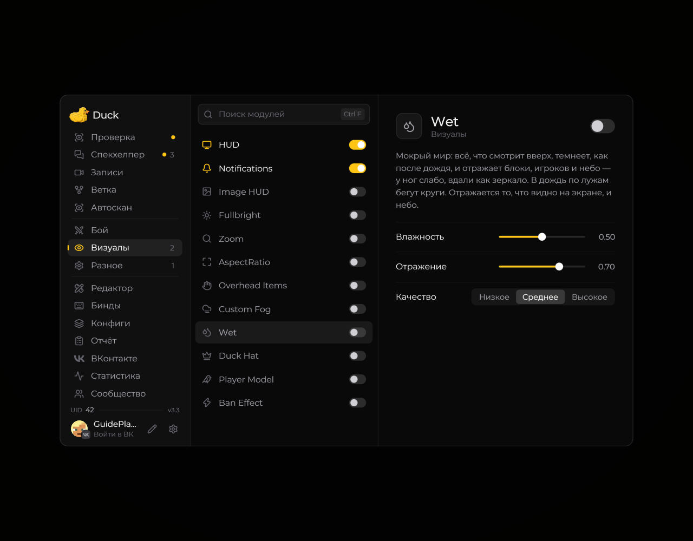

# Wet — мокрые поверхности

Модуль **Wet** добавляет визуальный эффект мокрых поверхностей.

<!-- screenshots-3.3 -->
<figure><figcaption>
Wet — мокрые поверхности — настройки · Duck Util 3.3.
</figcaption></figure>
<!-- /screenshots-3.3 -->

Включите его и настройте доступные параметры на странице модуля. Эффект влияет только на изображение в вашем клиенте.
