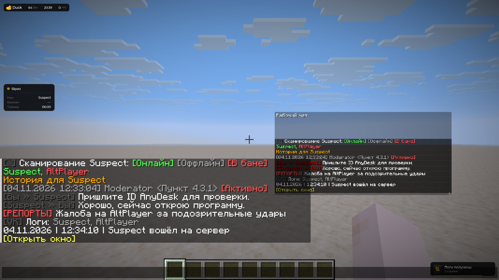

# Рабочий чат

Включите **Right Shift → Визуалы → HUD → Рабочий чат**. По умолчанию этот элемент выключен. Он показывает рабочие сообщения отдельным окном с обычным шрифтом Minecraft.

Рабочий HUD не дописывает сообщения в основной чат. Обычные рабочие ответы копируются из основного чата; скрытые репорты и строки логов отдельного окна VK принимаются напрямую только в HUD.

<figure><figcaption>
Рабочий чат · Duck Util 3.4. Демонстрационные сообщения в отдельном тестовом мире.
</figcaption></figure>

## Что попадает в окно

| Категория | Содержимое |
| --- | --- |
| Дюпайп | Видимые заголовки и списки аккаунтов из `/dupeip` |
| История | Заголовки и строки наказаний из `/hist` и `/history` |
| Переписка проверки | Входящие и исходящие ЛС с активным проверяемым, вызов и статусы проверки |
| Репорты | Сообщения `[РЕПОРТЫ]`, в том числе скрытые из основного чата настройкой модерации |
| Логи | Результаты логов игроков и ссылка на их окно; логи VK доступны также при выводе отдельным окном |
| Служебные ответы | Краткие итоги скана, статусы слежки, результаты наказаний и ошибки рабочих команд |

**Тихие технические ответы автоскана и «Ветки» не раскрываются.** Большие скрытые пачки `/dupeip` и историй в рабочую ленту не добавляются. Обычная игровая болтовня и ЛС от посторонних игроков также отфильтрованы.

## Префикс переписки

Только в рабочем HUD начало сообщения вида **`[игрок > проверяющий]`** и в обратную сторону оформлено **тёмно-красным жирным — `&4&l`**. Поддерживаются разделители `>` и `»`, собственный ник проверяющего и серверное «Вы».

Остальной текст сохраняет оформление. Обычный чат показывает префикс в серверном цвете и начертании. Исходные ссылки и подсказки сохраняются; красные ники открывают `/hist` через обычный обработчик Minecraft.

## Размер и управление

Откройте обычный чат, чтобы работать с окном:

- **ЛКМ по свободному месту или заголовку** — переместить.
- **Нижний правый угол** — растянуть по ширине и высоте.
- **Колесо над окном** — прокрутить историю.
- **ЛКМ по ссылке** — выполнить её обычное действие в Minecraft.
- **ПКМ** — открыть мини-настройки.

| Параметр | По умолчанию | Диапазон |
| --- | --- | --- |
| Ширина | 720 | 260–1200 |
| Высота | 300 | 80–700 |
| Шрифт | 1× | 0,6–1,5× |
| Фон | 55% | 0–100% |
| Сообщения видны | 30 секунд | 0–120 секунд |

Размеры приведены в единицах HUD; окно подстраивается под доступный экран. При времени **0** сообщения не затухают. В открытом чате доступна вся сохранённая история. В **Рабочих сообщениях** можно отключать отдельные категории.

Хранятся последние **200 сообщений** в памяти текущего подключения. Переподключение и очистка обычного чата очищают рабочую историю. Положение, размеры и остальные настройки сохраняются в конфиге.
