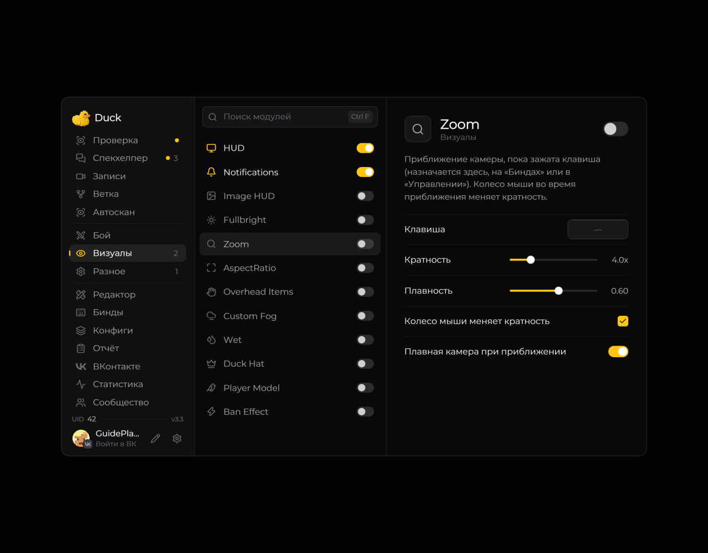

# Zoom — приближение

Модуль **Zoom** приближает изображение, пока нажата назначенная клавиша.

<!-- screenshots-3.3 -->
<figure><figcaption>
Zoom — приближение — настройки · Duck Util 3.3.
</figcaption></figure>
<!-- /screenshots-3.3 -->

По умолчанию клавиша не назначена. Откройте страницу **Zoom**, выберите привязку в настройках мода или Minecraft, затем удерживайте её в игре, чтобы приблизить изображение.
