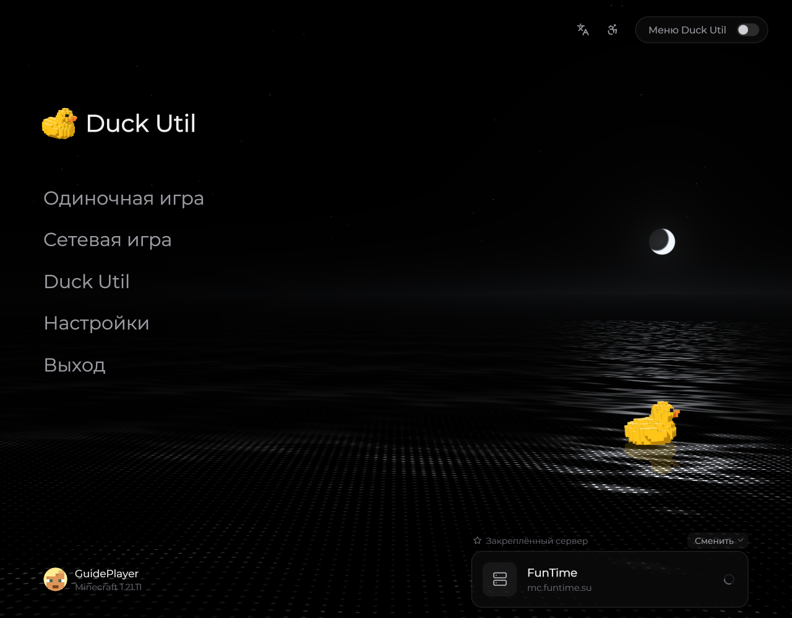

# Первый запуск

Запустите Minecraft через профиль Fabric, в котором установлены Fabric API и Duck Util.

<!-- screenshots-3.3 -->
<figure><figcaption>
Главное меню Duck Util: ночное озеро и уточка · Duck Util 3.3.
</figcaption></figure>
<!-- /screenshots-3.3 -->

## Открыть меню

Нажмите **Right Shift**. В меню можно открыть разделы и настроить модули. Если клавиша занята, найдите привязку Duck Util в **Настройки → Управление → Назначение клавиш** и выберите другую.

## Активация

Для большинства функций нужна активная лицензия. Если при запуске появится экран активации, введите выданный вам ключ и следуйте подсказкам на экране. Получайте ключ только через официальный источник, указанный создателем мода. Не публикуйте ключ и не отправляйте его вместе с логами.

Без активной лицензии доступны экран лицензии, тема оформления и часть функций оптимизации; остальные функции могут быть отключены.

## С чего начать

1. Откройте меню клавишей **Right Shift**.
2. Выберите нужные модули и включайте их по одному.
3. Наведите курсор на настройку, чтобы прочитать встроенную подсказку.
4. Откройте [редактор HUD](../nastroika/hud-editor.md), чтобы расположить элементы на экране.
5. Если потерялись, вернитесь к [обзору возможностей](../vozmozhnosti/overview.md) или [списку клавиш](../nastroika/keybindings.md).

Настройки обычно сохраняются автоматически. При переносе на другой компьютер воспользуйтесь облачной синхронизацией, если она доступна в вашей версии мода.
