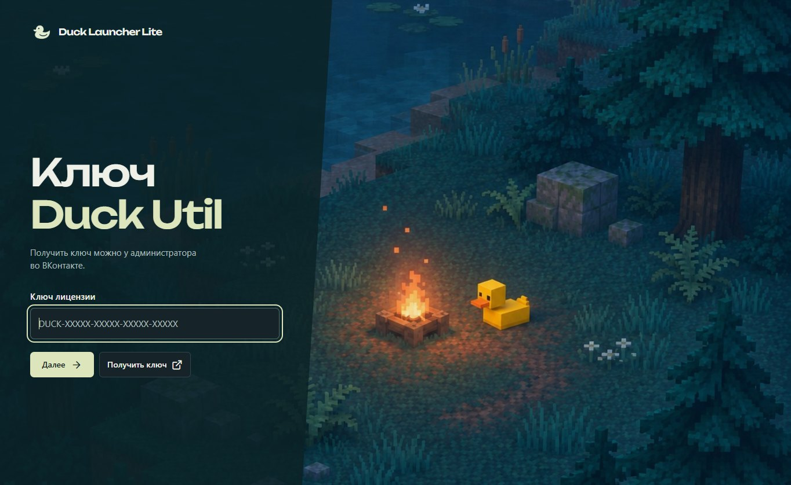
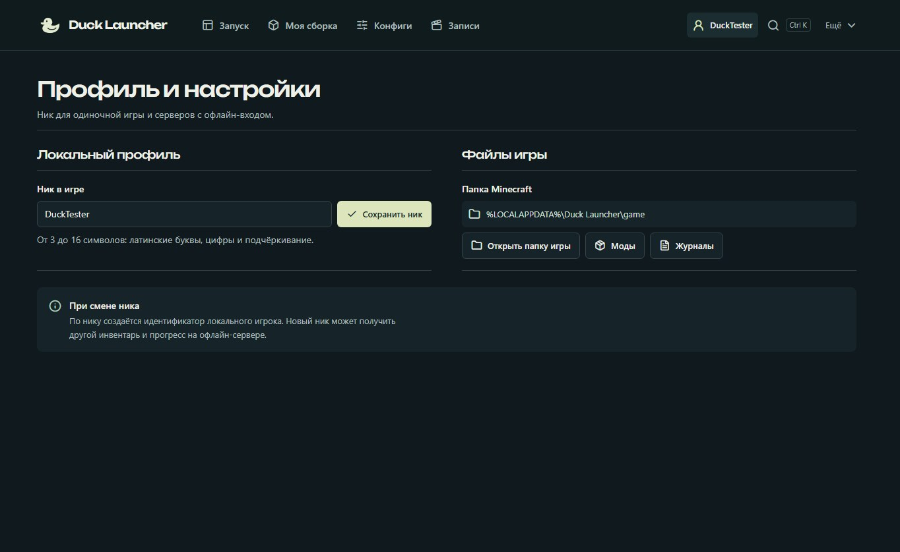
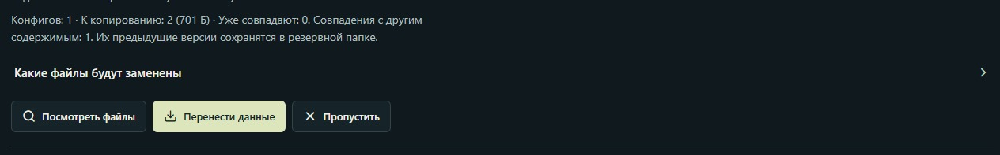

# Установка

## Duck Launcher Lite для Windows

Для Windows 10/11 x64 скачайте `Duck-Launcher-4.1-Lite-Windows-x64.exe`. В комплект входят Duck Util 4.1, Fabric Loader 0.19.3 и Fabric API для Minecraft 1.21.11. Для окна используется Microsoft WebView2. На ПК без WebView2 установщик Microsoft загрузит компонент.

1. Откройте EXE. В левой панели **Ключ Duck Util** вставьте ключ и нажмите **Далее**. Если ключа ещё нет, кнопка **Получить ключ** откроет [страницу администратора во ВКонтакте](https://vk.ru/1wanttopiglet).
2. На вкладке **Запуск** нажмите **Установить сборку**. Lite загрузит Minecraft и собственную Java 21, всего около 572 МиБ. Если соединение прервётся, повторите установку. Уже проверенные файлы будут использованы снова.
3. В **Профиле** сохраните ник из 3–16 латинских букв, цифр или подчёркиваний.
4. На вкладке **Запуск** нажмите **Играть**. Lite запустит Minecraft с этим ником. Локальный профиль подходит для одиночной игры и серверов с офлайн-входом. Для Realms и серверов с проверкой аккаунта нужен авторизованный профиль.

После успешной активации Lite сохраняет ключ и автоматически проверяет его при каждом открытии и перед запуском Minecraft. Мод автоматически использует тот же ключ. Для обеих проверок нужен интернет. При сбое связи нажмите **Повторить проверку**.

### Папки и профиль

Duck Launcher Lite хранит игру в `%LOCALAPPDATA%\Duck Launcher Lite\game`. Внутри находятся моды, миры, конфиги и записи. Открыть эти файлы можно в **Профиле**. Лаунчер работает независимо от обычной папки `.minecraft`. Если изменить ник, офлайн-сервер может считать вас другим игроком.

* **Конфиги → Импортировать** переносит файл `.duck` из другой установки. В игре откройте меню Duck Util и примените конфиг. Экспорт доступен в строке нужного файла.
* **Записи** показывает видео смен и клипы. Их можно искать по названию, сортировать и открывать в видеоплеере Windows.
* **Ещё → Диагностика → Проверить файлы** сверяет Minecraft, Fabric и Duck Util. Для повторной установки откройте **Моя сборка**. Миры и конфиги сохраняются.

### Топ модераторов

В Duck Launcher Lite откройте **Топ** в верхней панели. Слева показаны подтверждённые смены, справа — баны. В каждой колонке до 20 игроков. В строке видны место, ник Minecraft, число событий и аватар Discord, если мод смог его получить. При ошибке подключения попробуйте кнопку **Обновить**.

Duck Util с действующей лицензией автоматически передаёт статистику с начала сбора. Для смены нужен вход на FunTime и подтверждённая смена, которую мод увидел через tink.work. Баны учитываются по успешному ответу tink.work или распознанному подтверждению FunTime. Варны в рейтинг не входят. События, накопленные при временном обрыве связи, отправляются при следующем доступном подключении. Рейтинг работает через сервер Duck. Строки появляются по мере поступления подтверждённых событий.

### Перенос данных и обновления

**Профиль → Перенос из прежней игры** находит прежнюю установку Duck Launcher, обычную папку Minecraft и распространённые папки инстансов. Нестандартную установку можно указать кнопкой **Выбрать папку игры**. Закройте игру, выберите источник и нажмите **Посмотреть файлы**. Лаунчер покажет объём, совпадения и повреждённые конфиги. После **Перенести данные** активный профиль, файлы `.duck`, статистика, записи, клипы, разметка и архивы банов появятся в папке Lite. Архивы прежней системы отчётов доступны как файлы. При замене старые версии из Lite сохраняются в **Копии до переноса**. Если исходные видео OBS лежат отдельно, укажите **Папка видео OBS**. Файлы входа VK и Tink переносятся по отдельной отметке. В Lite используется ключ, активированный при входе в лаунчер.

Перед стартом игры Lite проверяет обновления Duck Util, включая новые версии мода для Minecraft 1.21.11. Если сервер повысил минимальную версию, актуальный Lite загружает совместимую сборку и повторяет проверку ключа. Ручная проверка доступна в **Ещё → Обновления**.

## Что понадобится для ручной установки

* Minecraft **1.21.11**.
* **Fabric Loader 0.19.3 или новее** для профиля Minecraft 1.21.11.
* **Fabric API** для Minecraft 1.21.11.
* **Java 21 или новее**. Некоторые лаунчеры устанавливают подходящую Java автоматически.
* Файл Duck Util `.jar`, полученный из официального источника проекта.

> Проверьте, что Fabric API и Duck Util предназначены для той же версии Minecraft. Не переименовывайте файл мода.

## Ручная установка

1. Установите Fabric для Minecraft 1.21.11 и запустите созданный профиль один раз.
2. Откройте папку игры. В стандартном лаунчере Windows нажмите **Win + R**, введите `%appdata%\.minecraft` и нажмите Enter. Если у лаунчера отдельная папка игры, откройте именно её.
3. Откройте папку `mods`. Если её нет — создайте.
4. Поместите в `mods` Fabric API и файл Duck Util `.jar`.
5. Запустите профиль Fabric для Minecraft 1.21.11.

Мод устанавливается только в ваш клиент: серверу Fabric и отдельной установке на сервере он не требуется.

## Обновление или переустановка

Закройте игру, удалите старый файл Duck Util из `mods`, затем положите туда новую версию. Не держите в папке одновременно две версии мода. Обычные настройки хранятся отдельно от JAR-файла.

Актуальный выпуск — **4.1**. После запуска проверьте версию внизу меню Duck Util. Настройки и выбранная включённость модулей сохраняются; если переключатели сбросились на старой версии, смотрите [разбор этой проблемы](../reshenie-problem/common-issues.md). Новые функции и изменения — в [истории обновлений](../reference/changelog.md).

Если игра не запускается, проверьте [частые проблемы](../reshenie-problem/common-issues.md).
