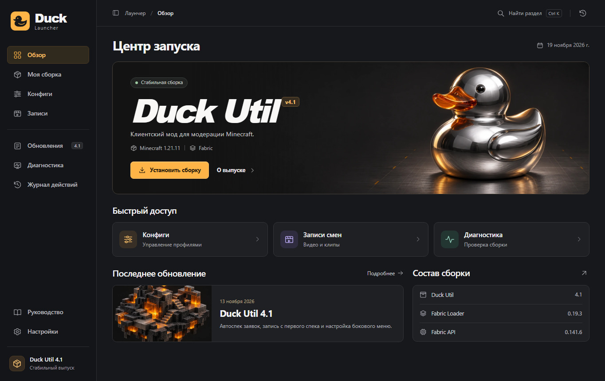

# Установка

Duck Util устанавливается как обычный мод Fabric и работает на стороне клиента.

## Duck Launcher для Windows

Для Windows 10 и 11 x64 у проекта есть один файл `Duck-Launcher-4.1-Windows-x64.exe`. В нём уже есть Duck Util 4.1, Fabric Loader 0.19.3, Fabric API 0.141.6 для Minecraft 1.21.11 и библиотеки загрузчика.

1. Закройте Minecraft и Minecraft Launcher. Откройте EXE. При первом запуске он распакуется в профиль текущего пользователя.
2. Нажмите **Установить сборку** на главном экране. По умолчанию лаунчер использует отдельную папку `%APPDATA%\.minecraft\instances\Duck-Util-4.1`. Если Duck Util уже установлен и вы хотите видеть его конфиги и записи, сначала откройте **Моя сборка** и выберите прежнюю папку игры.
3. Нажмите **Открыть Minecraft Launcher**. Если программа ещё не установлена, в настройках Duck Launcher доступна официальная страница загрузки Minecraft Launcher.
4. Войдите в аккаунт с доступом к Minecraft Java Edition, выберите профиль **Duck Util 4.1** и нажмите **Играть**. На чистом ПК для загрузки игровых файлов нужен интернет. Ключ Duck Util вводится в окне мода.

### После установки

* **Конфиги** показывает файлы `.duck` выбранной игровой папки. Экспортируйте нужный конфиг, чтобы передать его на другой ПК. После импорта выберите его в игровом меню Duck Util.
* **Записи** объединяет видео смен и клипы. Можно найти файл по названию, отсортировать по дате или размеру и открыть в видеоплеере Windows.
* **Диагностика → Проверить файлы** сверяет файлы по SHA-256 и проверяет профиль. Чтобы восстановить комплект, откройте **Моя сборка → Восстановить сборку**. Результат появится в журнале действий.

## Что понадобится для ручной установки

* Minecraft **1.21.11**.
* **Fabric Loader 0.19.3 или новее** для профиля Minecraft 1.21.11.
* **Fabric API** для Minecraft 1.21.11.
* **Java 21 или новее**. Некоторые лаунчеры устанавливают подходящую Java автоматически.
* Файл Duck Util `.jar`, полученный из официального источника проекта.

> Проверьте, что Fabric API и Duck Util предназначены для той же версии Minecraft. Не переименовывайте файл мода.

## Ручная установка

1. Установите Fabric для Minecraft 1.21.11 и запустите созданный профиль один раз.
2. Откройте папку игры. В стандартном лаунчере Windows нажмите **Win + R**, введите `%appdata%\.minecraft` и нажмите Enter. Если у лаунчера отдельная папка игры, откройте именно её.
3. Откройте папку `mods`. Если её нет — создайте.
4. Поместите в `mods` Fabric API и файл Duck Util `.jar`.
5. Запустите профиль Fabric для Minecraft 1.21.11.

Мод устанавливается только в ваш клиент: серверу Fabric и отдельной установке на сервере он не требуется.

## Обновление или переустановка

Закройте игру, удалите старый файл Duck Util из `mods`, затем положите туда новую версию. Не держите в папке одновременно две версии мода. Обычные настройки хранятся отдельно от JAR-файла.

Актуальный выпуск — **4.1**. После запуска проверьте версию внизу меню Duck Util. Настройки и выбранная включённость модулей сохраняются; если переключатели сбросились на старой версии, смотрите [разбор этой проблемы](../reshenie-problem/common-issues.md). Новые функции и изменения — в [истории обновлений](../reference/changelog.md).

Если игра не запускается, проверьте [частые проблемы](../reshenie-problem/common-issues.md).
