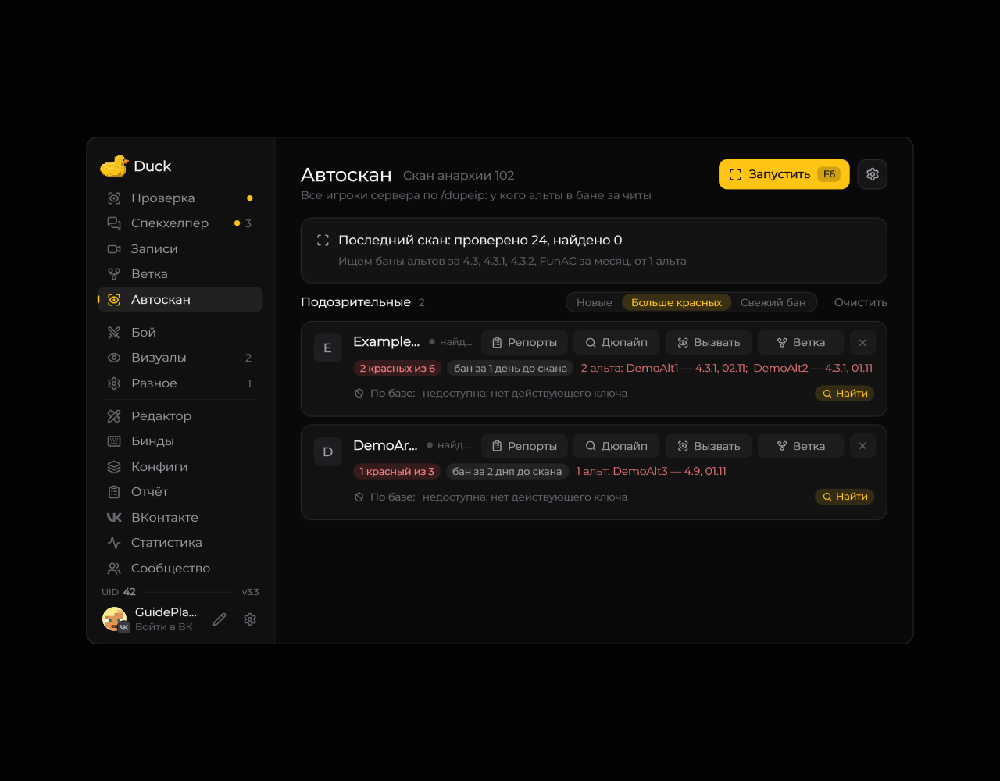
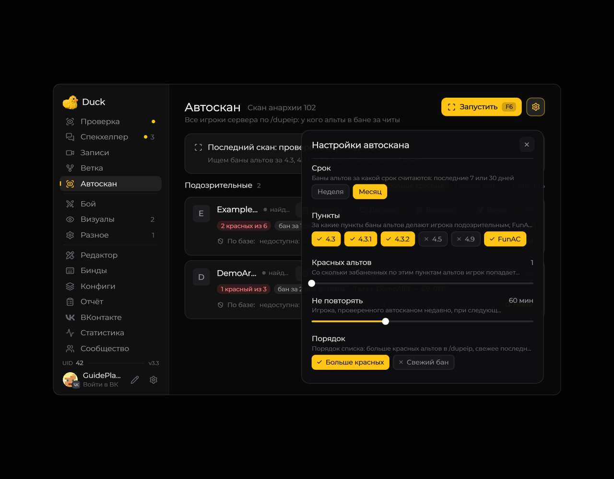

# Автоскан

Автоскан проходит по игрокам сервера и собирает подозрительные аккаунты по банам связанных ников.

<figure><figcaption>
Автоскан: состояние и найденные игроки · Duck Util 3.3. Демонстрационные данные.
</figcaption></figure>

**F6** запускает скан, **F7** останавливает; клавиши меняются в **Биндах**. Шестерёнка открывает срок поиска, пункты, порог, сортировку и задержки команд. Для работы нужны поддерживаемые команды и права на игровом сервере.

<figure><figcaption>
Настройки автоскана · Duck Util 3.3. Демонстрационные данные.
</figcaption></figure>

[Все параметры Auto Scan](../moduli/auto-scan.md)
