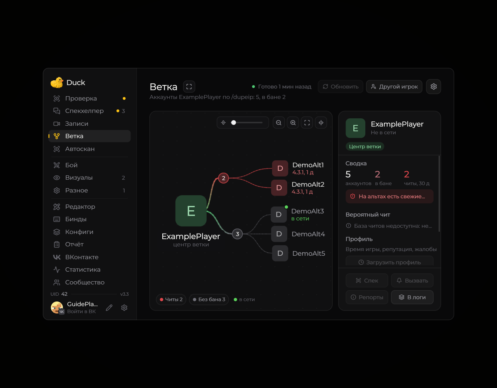
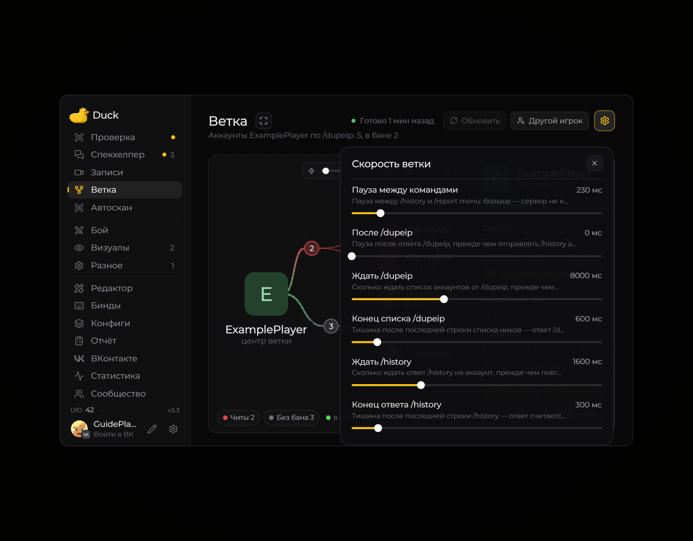

# Ветка аккаунтов

Страница «Ветка» показывает связанные аккаунты в виде дерева: центр — выбранный игрок, справа — карточка выделенного аккаунта.

<figure><figcaption>
Дерево аккаунтов и сводка · Duck Util 3.3. Демонстрационные данные.
</figcaption></figure>

Нажмите **Другой игрок**, чтобы задать ник. Для построения используются команды игрового сервера /dupeip, /history и /report menu. Колесо меняет масштаб дерева; кнопки над ним помогают вернуть удобный вид.

Настройка скорости

<figure><figcaption>
Паузы между запросами ветки · Duck Util 3.3. Демонстрационные данные.
</figcaption></figure>

[Параметры Branch](../moduli/branch.md)
