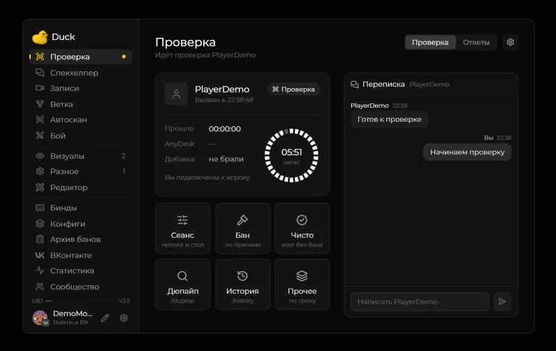

# Проверка

Включите **Right Shift → Разное → Interface → Меню → Old (revise)**. После этого откройте **«Проверка»** в левой колонке. Вызвать игрока можно через **V → Вызвать на проверку**. Для вызова нужны серверные права и поддержка `/revise`.

Окно показывает стадию, время и переписку с проверяемым. Команда `/settimer 1–60` меняет таймер HUD во время проверки. Через шестерёнку можно настроить HUD, копирование присланного ID, снятие метки и запись итога в локальный архив.

## Быстрые ответы

Во вкладке **Ответы** находятся заготовленные сообщения. Их можно редактировать и группировать по категориям.

<figure><figcaption>
Вкладка быстрых ответов · Duck Util 3.3. Демонстрационные данные.
</figcaption></figure>

## Завершение

Карточки **Бан**, **Чисто** и **Прочее** открывают соответствующие варианты завершения.

<figure><figcaption>
Выбор причины наказания · Duck Util 3.3. Демонстрационные данные.
</figcaption></figure>

Итоги проверки можно хранить в [«Архиве банов»](report-screen.md).
