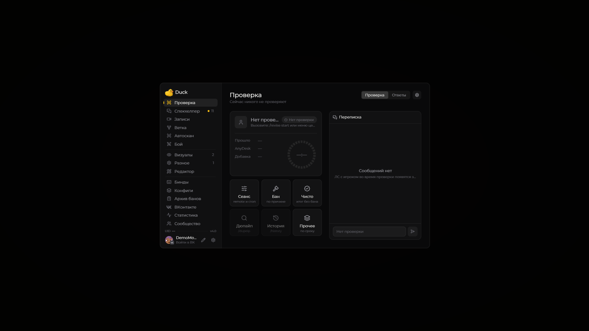
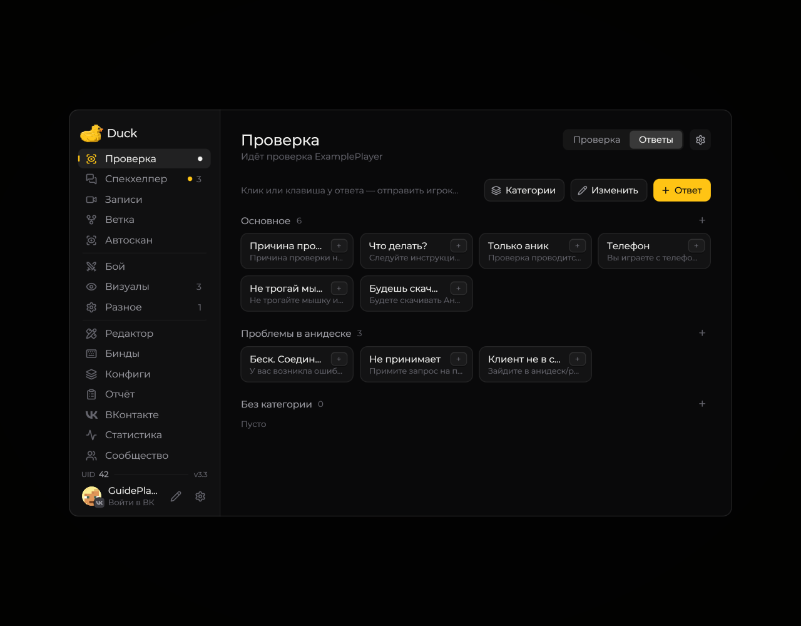
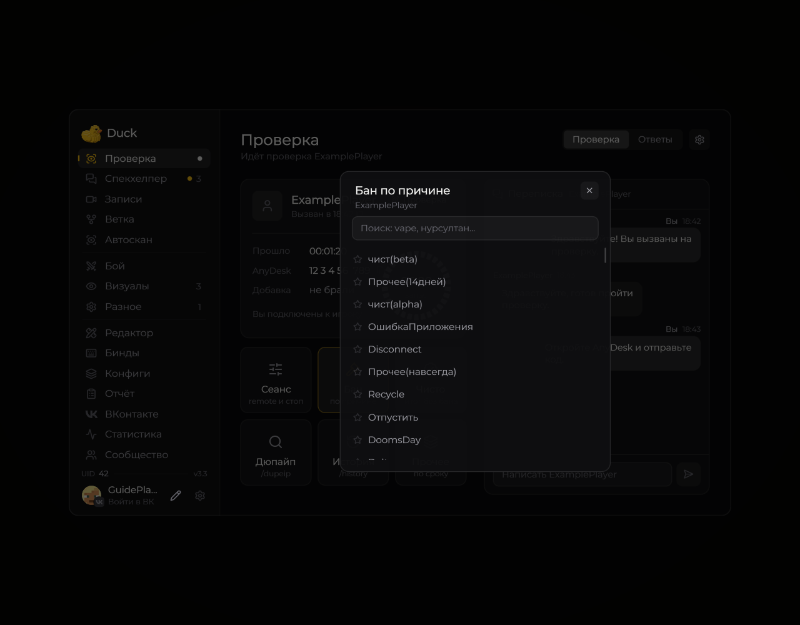
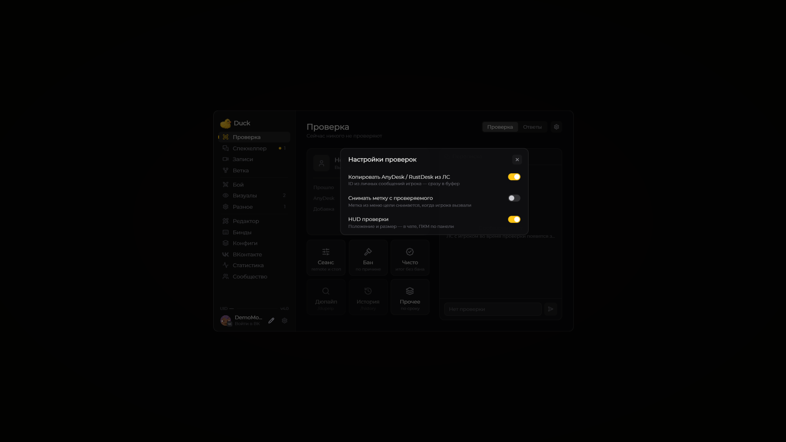

# Проверка

Включите **Right Shift → Разное → Interface → Меню → Old (revise)**. После этого откройте **«Проверка»** в левой колонке. Вызвать игрока можно через **V → Вызвать на проверку**. Для вызова нужны серверные права и поддержка `/revise`.

Окно показывает стадию, время и переписку с проверяемым. Команда `/settimer 1–60` меняет таймер HUD во время проверки. Через шестерёнку можно настроить HUD, копирование присланного ID и снятие метки.

## Новый формат переписки и AnyDesk

Поддерживаются оба направления с **«->»**, старым **«»»** и **«→»**, в том числе **\[Проверяющий -> Вы]**, **\[Вы -> Проверяющий]** и **\[Ник -> Вы]**. Вложенные компоненты сообщения читаются как единый видимый текст. В пузырях переписки не дублируются время сервера, скобки и стрелки оболочки.

При активной проверке в **Old (revise)** входящий **#ANYDESK(ID)** или **#RUSTDESK(ID)** сохраняет ID для карточки. С включённой по умолчанию настройкой **«Копировать AnyDesk / RustDesk из ЛС»** в буфер попадают только цифры. ЛС посторонних игроков не заменяют ID текущей проверки.

Клик по всей метке удалённого подключения копирует ID и в основном, и в рабочем чате. История красных ников не перезаписывает это действие; подсказка и действие серверной отметки времени сохраняются.

В [рабочем чате](../moduli/work-chat.md) переписка активной проверки доступна в категории **«Проверки»**, включённой по умолчанию. Сам рабочий чат включается отдельно в HUD. С выключенным Old (revise) отслеживание переписки проверки выключено.

## Быстрые ответы

Во вкладке **Ответы** находятся заготовленные сообщения. Их можно редактировать и группировать по категориям.

<figure><figcaption>
Вкладка быстрых ответов · Duck Util 3.3. Демонстрационные данные.
</figcaption></figure>

## Завершение

Карточки **Бан**, **Чисто** и **Прочее** открывают соответствующие варианты завершения.

<figure><figcaption>
Выбор причины наказания · Duck Util 3.3. Демонстрационные данные.
</figcaption></figure>

Система отчётов удалена, поэтому после завершения нет выбора категории и записи в локальный журнал. Отметки наказаний для видео сохраняются.

